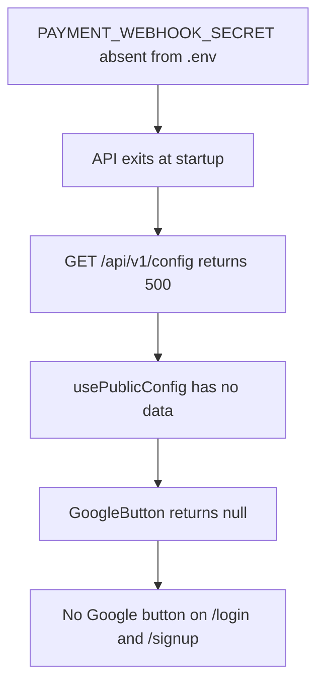

# Acceptance tests and release evidence

This checklist defines completion for the sixteen steps in [IMPLEMENTATION_ORDER.md](./IMPLEMENTATION_ORDER.md). A checked box must link to evidence from a named environment/commit; implementation presence alone is insufficient.

## Evidence baseline

Historical session checks: 38 backend tests passed after Gmail changes; TypeScript and backend build passed; Gmail authentication verified natively and inside Docker; four diagnostic email templates accepted by Gmail. Earlier frontend checks and a mock-AI browser journey through PDF download passed. Inbox receipt, real AI writing quality, paid billing, disaster recovery and production performance were not established by those checks.

Do not rerun the Mailpit-dependent browser journey against real Gmail. Use a dedicated test stack with isolated database, queues, asset storage, captured email and mock AI. Live SMTP/AI/payment checks require explicitly scoped accounts, recipients, budgets and safe test data.

## Step acceptance matrix

| Step | Positive scenario | Failure/concurrency scenario | Evidence required |
| --- | --- | --- | --- |
| S01 | API schedules work and its worker returns a retrievable result | Different environments cannot cross-consume; repeated request is one operation; foreign owner denied | Configuration/isolation test, operation API test and actual artifact retrieval |
| S02 | User saves, recovers a browser draft and restores a revision | Offline/refresh/quota error/two tabs/history race/stale suggestion preserve recovery choices | API concurrency results and browser recovery walkthrough |
| S03 | Approved outline produces durable sections and a coherent book | Worker crash, lost lease, dispatch gap, duplicate delivery and cancel settle credits correctly | Checkpoint fault tests, reconciled ledger and reviewed writing samples |
| S04 | Eligible code is delivered/accepted, verifies once and resets password | SMTP outage/retry, expiry, superseded resend, attempt limits and unknown account | Captured-mail tests, safe logs, queue expiry proof and separately scoped live SMTP check |
| S05 | User organizes, archives, duplicates and restores planning | Foreign assignment, pagination ties and outline changes cannot lose writing | API ownership tests and multi-book browser journey |
| S06 | Safe upload becomes a private reusable asset | Malformed/huge input, interrupted upload, foreign access and referenced deletion handled | Processing tests, storage/retrieval proof and upload UI journey |
| S07 | User creates/reopens/edits/exports a cover and inserts an illustration | Provider failure/cancel/repeat request does not destroy concepts or double-charge | Image job/ledger tests, cover artifact and typography review |
| S08 | Template application persists in digital and print preview | Missing glyph/font, long table, RTL/mixed text and stale design update handled | Language fixture review, reversible settings test and preview/export comparison |
| S09 | Known defects produce correctly anchored findings | Clean fixtures, edited/missing anchors and stale reports avoid misleading results | Curated report evaluation with detection limitations and browser navigation |
| S10 | PDF/EPUB/DOCX validate, download and open | Bad assets, corrupt file, unavailable storage and interrupted upload never report false readiness | Validator reports, file hashes/downloads and reader/editor opening record |
| S11 | Source import previews/applies and Q&A links real passages | Hostile file/prompt injection, unsupported scan and duplicate confirmation handled | Extraction/security tests, idempotent import and passage-level source review |
| S12 | Verified purchase grants the correct entitlement/credits | Bad signature, duplicate/out-of-order event, refund and concurrent spend reconcile | Local provider event records, independent ledger/entitlement assertions, and Stripe's own sandbox through the CLI listener; a live processor is not connected |
| S13 | Operator diagnoses a failure and restores a backup safely | Ordinary user denied, unsafe intervention rejected, alert failure surfaced | Permission tests, audit trail, alert receipt and isolated restore report |
| S14 | Destination package contains selected validated files/metadata | Missing files, stale input and foreign package access handled | ZIP manifest/checksums, rules version and manual publishing checklist review |
| S15 | Marketing variants persist, edit and download | Regeneration preserves user edits; stale inputs and invented claims are reviewed | Asset/history tests, reviewed outputs and actual downloads |
| S16 | Complete release journey succeeds in staging | Outages, rollback, scale, expired sessions and recovery remain controlled | Signed-off release record with all required gates and limitations |

## Shared functional requirements

- [ ] Every persisted resource and nested download enforces ownership/roles.
- [ ] Every visible action works or is explicitly unavailable; no placeholder success messages.
- [ ] Validation and loading/error/permission states have meaningful user actions.
- [ ] Paid operations show estimates and charge/refund according to one documented policy.
- [ ] Repeated clicks, retries and uncertain responses do not create duplicate effects.
- [ ] Concurrent edits return conflicts without losing recoverable data.
- [ ] Session expiry and reauthentication preserve safe recovery choices.
- [ ] Polling is bounded, resumes after reconnect and stops for terminal states.
- [ ] Private cached data and local drafts cannot cross accounts.
- [ ] Auth responses/logging do not expose credentials, OTPs or unnecessary account-existence information.

## Artifact and content review

Use small, medium and long books containing headings, lists, quotes, tables, links, images/captions, front/back matter and source citations. Include empty/incomplete content and corrupted assets intentionally.

- [ ] PDF page layout, font rendering, TOC/link targets, image resolution and selected print settings reviewed.
- [ ] EPUB conformance report has no unresolved blocking errors; navigation, metadata, cover, links and reading order checked.
- [ ] EPUB accessibility checked separately from structural validation; document remaining limitations.
- [ ] DOCX opens with editable styles, headings/tables/images/links and documented TOC behavior.
- [ ] Cover output uses correct dimensions and reproduces saved editable overlays.
- [ ] Distribution ZIP contains safe paths, expected file versions and the full reviewed manifest.
- [ ] Marketing/sample-chapter downloads open and match their stated source version.
- [ ] Files remain retrievable after a worker/container restart and from the deployed API, not only from a worker's local disk.

AI review uses a curated brief/outline set and human assessment of usefulness, factual support, originality concerns, repetition, voice, continuity, examples and target length. Record model/configuration, prompt version, token usage/cost and reviewer observations. Mock outputs establish orchestration behavior only. Quality scores and similarity checks must not be presented as accuracy/originality certificates.

## Language and accessibility matrix

| Fixture | Verify in editor and preview | Verify in each export |
| --- | --- | --- |
| English/Latin | Headings, punctuation, links, search/replace | Font embedding, line breaks and navigation |
| Bengali | Conjuncts, vowel signs, cursor/selection, mixed English terms | Glyph shaping, wrapping, selectable text and title/cover layout |
| Arabic RTL | Logical reading order, lists/tables, mixed numbers/Latin terms | Direction metadata, shaping, navigation and paragraphs |
| Representative CJK | Input, wrapping, counts and long headings | Font coverage, line breaking and overflow |
| Mixed/long content | Images, captions, long tables and narrow screens | No clipping, missing assets or broken structural references |

- [x] Keyboard users can reach and operate all controls, including reorder and design positioning. *Verified 21 November 2026 by `backend/tests/accessibility.test.ts` (33 tests): chapter reordering, design tabs, the radio group, the AI-assist menu, dialogs, focus rings and announcements. No screen-reader session was recorded.*
- [x] Dialogs trap/restore focus correctly; labels and error descriptions are meaningful. *Verified 21 November 2026 by `backend/tests/accessibility.test.ts`: every dialog has a unique accessible name, a described dialog is wired to its description, and `Escape` and the open state stay in step.*
- [x] Save/generation/validation changes have appropriate announcements without excessive noise. *Verified 21 November 2026 by `backend/tests/accessibility.test.ts`: the editor save state is announced politely, a save failure assertively, and the visible label stays in step with the announcement.*
- [x] Contrast, zoom, touch targets, responsive layout and reduced motion pass review. *Partly verified 21 November 2026: WCAG AA 4.5:1 contrast and `prefers-reduced-motion` are asserted by `backend/tests/accessibility.test.ts`, and the product's own screens were reviewed responsively. Zoom and touch targets are covered by the token rules rather than by measurement, and no real device, browser or screen-reader session was recorded.*
- [ ] Supported manuscript languages and UI translation scope are stated accurately.

## Reliability, security and operational checks

- [ ] Prove queue namespaces and worker/database/storage compatibility across local, test, staging and production.
- [ ] Kill workers at dispatch, provider response, checkpoint, charge and upload boundaries; reconcile resulting state.
- [ ] Confirm lease fencing prevents a stale worker from committing.
- [ ] Test unavailable Redis/database/storage/SMTP/provider services and subsequent recovery.
- [ ] Review auth/origin/CSRF controls, request sizes, rate limits, upload parsing, source SSRF and privileged endpoints.
- [ ] Verify payment signature handling and provider reconciliation without relying on browser success pages.
- [ ] Verify encryption keys, token-payload expiration, secret redaction and data/backup retention rules.
- [ ] Restore database and assets into an isolated environment and open recovered books/files.
- [ ] Demonstrate alert delivery and operator runbooks without automatic unauthorized external messaging.
- [x] Load-test measured book sizes/concurrency and record response time, editor responsiveness, memory, queue age and cost budgets. *Done 21 November 2026. `backend/tests/load.test.ts` passes (7 tests). An 8-chapter book of about 57,600 characters: read p95 107 ms against a 250 ms budget, save p95 128 ms against 1,000 ms, editor open p95 41 ms against 1,500 ms, memory growth 12.4 MB against 250 MB. The budgets are in [LOAD_BUDGETS.md](./LOAD_BUDGETS.md). The 15-minute queue age is the enforced limit, not a measured age.*
- [ ] Document rollback/forward repair for migrations and compatibility during staggered worker deployment.

Recovery targets, performance budgets, supported file sizes and production concurrency must be explicitly approved before their tests are considered passing. Do not invent a universal SLA from local development results.

## Test and release execution

Existing commands:

```sh
pnpm typecheck
pnpm --filter frontend lint
pnpm --filter backend test
pnpm --filter backend build
pnpm --filter frontend build
pnpm e2e
```

Use targeted checks while implementing a step and the full regression suite at release boundaries. Browser tests must verify actual API results, downloaded files and credit changes. Wait for concrete saved/job states; manuscript text containing “Saved” is not a valid save assertion.

A future Playwright suite may replace/extend Puppeteer only after equivalent assertions pass. Keep the old working journey until coverage migration is demonstrated.

## Final release gate

- [ ] S01–S15 gates complete with evidence for the advertised scope. *S01–S15 are done and their evidence is in this file. The remaining items below are the ones still open, and they are recorded as open rather than checked.*
- [ ] Zero unresolved critical data-loss, ownership, payment-accounting or invalid-export defects.
- [ ] Important residual issues have an owner, customer impact and explicit release decision.
- [ ] Actual release artifact, commit, configuration and migration versions recorded.
- [ ] Staging registration-to-package/marketing journey passed with approved live-provider checks separately recorded.
- [ ] Production backups, restore/rollback procedure, readiness and alert destinations verified.
- [ ] Published feature/language/format claims match implemented and tested capabilities.
- [ ] Release decision and follow-up monitoring owner recorded.

## Evidence record template

```text
Step / requirement:
Status: not run | passed | failed | blocked
Commit / build / migration version:
Environment and relevant non-secret configuration:
Dataset / book size / languages / provider mode:
Commands and test identifiers:
Expected result and observed result:
Artifact / validator / audit / screenshot references:
Cost and performance measurements where relevant:
Remaining limitations / defect link / responsible owner:
Review date and release decision:
```

Do not fill this record with assumed passes. Store secrets, authentication tokens, customer manuscripts and live payment data outside shared evidence documents.

## S01 implementation evidence — 20 November 2026

Status: foundation gate passed; S02–S16 remain planned. Source changes are not a production rollout claim.

Implemented: shared operation/error/pagination schemas; durable owner/request/input identity; book/outline/writing/export submission replay and support references; durable queue dispatch retry records; namespace/configuration-specific BullMQ prefixes; worker capabilities with expiring heartbeats; cross-process private storage probes; bounded readiness; recent-activity UI; browser request-key recovery and account-change cache cleanup.

Verification:

- 48 backend tests passed, including real queue isolation, concurrent request replay, owner/deleted-book checks, changed-input rejection, uncertain submissions, broker-failure retry, unreadable worker probes and actual validated PDF download.
- Workspace TypeScript and frontend lint passed; backend and frontend production builds passed.
- Expanded browser journey passed against the production frontend with an isolated test-database/Mailpit/mock-AI API and worker: signup/OTP, wizard/outline, writing, idempotency headers, recent activity/support-reference action, autosave/history restore, AI suggestions, PDF download, credits and mobile dashboard.
- Isolated and native runtime readiness returned database/Redis/workers/storage all healthy.
- Additive migration `20261120130000_operation_foundation` applied to the isolated test and development databases.
- Existing Gmail configuration was preserved; browser test mail was captured in Mailpit and no paid AI requests were used.

Limits and rollout: domain job creation/reservation/outbox transaction gaps, orphan-credit reconciliation, exclusive processing/fencing and durable section checkpoints are S03 work. Uncertain requests are held for inspection rather than re-executed. Old unprefixed queues require an explicit drain/reconciliation cutover. Docker configuration/source is updated, but these checks do not constitute a new full Docker/production deployment. See [runtime runbook](../backend/RUNTIME.md).

Browser harness note: the temporary development-server proxy did not activate signup validation; using the release frontend with the same isolated API/worker passed the complete suite. No change to the signup form was needed.

## S02 and initial marketplace checks — 20 November 2026

Status: implemented and verified for the scenarios below; S02's complete resilience gate and S14's package gate remain open. No production deployment or marketplace approval is implied.

Implemented:

- Bounded structured-document grammar, supported nodes/marks/attributes, safe link protocols, depth and node limits before rendering or persistence.
- Serialized autosaves, explicit Save/keyboard shortcut, paused errors/conflicts, offline state and reconnection, retained failed edits, per-instance IndexedDB journal scoped by owner/chapter/base version.
- Explicit recovery review, conditional removal of recovered records, manual JSON backup, browser-close and clicked-navigation protection, storage-failure warnings.
- AI suggestions rejected if the document changed; cancelled suggestion responses cannot populate a newer request; oversized selections are rejected rather than silently truncated.
- Owner-protected publishing-check API and UI for KDP eBooks, Etsy, Gumroad and direct sales, versioned rules, official sources, JSON checklist download, and removal of the unverified print-ready label.

Verification:

- 53 backend tests passed: prior regressions plus bounded-document rejection/acceptance and marketplace language, format, file-size and review rules. API tests cover publishing report ownership and invalid destinations.
- Workspace TypeScript, frontend lint, backend build and frontend release build passed.
- Expanded Puppeteer browser journey passed against release frontend and isolated mock-AI/Mailpit API/worker: original signup-to-PDF journey, failed-save pause, draft persistence across reload, explicit recovery/manual save, concurrent server edit/OCC conflict pause and keep-mine, offline reconnect save, unavailable IndexedDB warning with successful server saving, marketplace destination selection and refreshed file checks after export. PDF response downloaded successfully (293184 bytes in this run).
- No paid AI requests or Gmail test delivery in this iteration. Screenshot collection disabled for this browser run.

Limits requiring further evidence/work:

- Concurrent server-edit test reproduces OCC through a second HTTP write; a full two-browser-tab editing/account-switch/logout matrix is still needed. Browser storage is local plaintext, isolated by application owner keys, not encryption against people with access to the browser profile.
- Failed IndexedDB access was simulated; actual disk-full/write-quota exhaustion, abrupt OS crash and termination during in-flight saves require additional failure tests. The final uncommitted keystroke cannot be guaranteed durable before IndexedDB commits. Existing recovery records are retained until explicit discard or successful recovery; retention controls remain pending.
- Navigation warning covers browser unload and clicked links/chapter buttons; programmatic routing/history can rely on the journal but does not yet have a universal navigation blocker.
- Backup download is JSON, not a completed import workflow. Stale AI guard is compiled and normal acceptance is browser-tested; a deliberately stale AI response race still needs its own browser fixture.
- Publishing checks inspect manuscript/export metadata, not live seller-account eligibility, file bytes or independent commercial rights. Current exports lack immutable snapshot identity and marketplace bundles. No eBook is automatically submitted or declared accepted.
- Frontend build initially failed under sandbox port restrictions; a permission-enabled retry repeated the diagnostic until the Turbopack cache was moved aside. A clean release build and subsequent warm build succeeded.

See [marketplace release track](./MARKETPLACE_RELEASE.md) for the prioritized remaining work. S03 transaction/checkpoint work remains the next dependency before commercial generation can be released.

## S03 generation recovery and S04 OTP delivery — 20 November 2026

Status: core implementations verified locally; production cutover and full release gates remain open. S05 is the next ordered implementation package.

S03 implemented:

- Transactional generation job, immutable input snapshot, credit reservation and outbox creation, with book-row serialization for starts and planning changes.
- Expiring worker leases, heartbeat and fenced writes; durable ordered sections and summaries; atomic manuscript revision/progress/charge commits; atomic terminal state/settlement.
- Matching-protocol lost-delivery reconciliation, cancellation checks before commits, preserved completed chapters, and reservation invariant checks.
- Read-only generation audit, sanitized job responses, saved-section/recovery UI and explicit behavior for new runs after cancellation/failure.

S04 implemented:

- AES-256-GCM encrypted, short-lived OTP outbox tied to actual verification IDs; atomic dispatcher claims and SMTP-runtime isolation.
- Bounded transient retries, permanent-failure handling, pre-send expiration/supersession/consumption/attempt checks, payload erasure and 14-day terminal metadata cleanup.
- Neutral UI wording, unchanged neutral Better Auth account responses, read-only email status counts, preserved direct SMTP diagnostic.

Verification:

- Full backend suite: **65 tests passed across 8 files**. Seven new generation recovery tests include concurrent starts, section reuse after lease loss, immutable inputs, a real child worker terminated with **SIGKILL** after a section commit, stale provider response fencing, transactional settlement rollback, lost Redis delivery reconciliation, and cancellation before a provider result commits (some tests cover multiple scenarios).
- Five new OTP delivery tests cover encryption, retry/acceptance/erasure, expired/consumed/attempt-exhausted/superseded codes, concurrent claims, permanent failures, tampering, retry limits, and successful verification using the actual Better Auth hash and expiry representation.
- Workspace type checking, frontend lint, backend build and frontend release build passed. `git diff --check` passed.
- Full Puppeteer browser workflow passed against the release frontend with an isolated mock-AI API/worker and **actual Mailpit SMTP delivery through the encrypted outbox**. Coverage retains signup/OTP, outline approval, generation, editor/history/AI acceptance, failed-save reload recovery, conflict handling, offline reconnect, unavailable IndexedDB, destination checks, valid PDF download (293184 bytes), credits and mobile dashboard. Screenshots disabled.
- Additive migrations `20261120143000_generation_checkpoints` and `20261120150000_email_delivery` applied to local test and development databases.
- Read-only local development generation audit returned no wallet mismatches and no jobs requiring review.
- No paid AI calls, Gmail diagnostic sends, marketplace submissions or production deployment performed in this iteration.

Remaining boundaries:

- Real process termination was tested at a section boundary, not every possible provider/network/commit boundary under production load. Provider billing can repeat when an external response is lost before durable checkpointing; customer chapter commits and settlement are fenced.
- Interrupted running jobs resume their saved sections automatically. Explicit retries after terminal failure/cancellation start a new job for unfinished chapters; cross-job partial-section reuse is not implemented.
- HTTP operation replay can still require operator review after a crash between domain commit and replay-response persistence. Historical ledger repairs are audited, not guessed automatically.
- Protocol 2 requires a deliberate drain/cutover from protocol 1. Existing Docker images were not rebuilt or deployed. See [RUNTIME.md](../backend/RUNTIME.md).
- SMTP cannot be atomically committed with PostgreSQL. A delivery may duplicate after acceptance followed by a process failure. Supersession during SMTP keeps the old code invalid, but cannot retract an already accepted message. The verification-to-outbox callback boundary still relies on a fresh resend after a process failure. Secret/configuration rotation invalidates pending dispatcher identity; see [EMAIL.md](../backend/EMAIL.md).
- Live Gmail inbox receipt, production alert delivery, operator permissions, restoration, payment/provider reconciliation, load/security/accessibility review and marketplace file validators remain separate release gates.

## S05 library and planning — 20 November 2026

Status: core library/planning gate passed locally. S06 private assets is next. This is not a production deployment or completion of later roadmap packages.

Implemented:

- `/app/projects`: create/edit descriptions and names, search, pagination, archive/restore, and project-to-library navigation. Project deletion unassigns its books instead of deleting them.
- Library filters for project/unassigned, language, type, status and archive state; newest/oldest/title ordering with ID tie-breakers, bounded cursor pagination, and filter/page state in the URL.
- Owner-checked project assignment/reassignment; book archive/restore distinct from soft deletion; explicit brief/outline-only or manuscript duplication. Copies have new identities and no credit spend, jobs, exports or copied revision history.
- Optional brief purpose, reader age, writing style, point of view, brand and terminology, with defaults and actual prompt integration. Progressive-disclosure form fields and account/tab-session-scoped IndexedDB recovery for unfinished briefs, independent of manuscript recovery.
- Outline version list/detail/preview and restore as a new unapproved plan. HTTP saves require `baseVersion`; approval requires the reviewed `version`. Stale saves/approvals/restores reject with conflict. Repeated approval of the same version preserves materialized chapter IDs.
- Restoring planning does not change manuscript chapters, order, text, history or book metadata. Structural approval/editing is blocked once manuscript edits exist; duplication provides a separate planning path.

Verification:

- **72 backend tests across 9 files passed**, including seven new library/planning tests: owner isolation, archived-project assignment rejection, metadata preservation, archive/deletion distinction, tied-timestamp pagination, bounded filters, independent manuscript duplication without credit spend, stale/missing version tokens, harmless repeated approval, written-manuscript preservation, busy-book rejection and deleted-book isolation.
- Workspace type checks, frontend lint, both builds, and `git diff --check` passed.
- Expanded Puppeteer journey passed with the release frontend, isolated test database, mock AI and Mailpit. It verifies wizard recovery after reload; original signup-to-PDF and edit-recovery flows; history restoration after writing with identical chapter metadata; project create/edit; assignment; URL filtering; book archive/restore; manuscript duplication; credits and mobile dashboard. PDF download validated (293184 bytes in this run). Screenshots disabled.
- Initial browser run found the wizard could be clicked while its recovery check was still loading. Explicit disabled submit controls and visible recovery-loading state fixed this; the complete rerun passed.
- Additive migration `20261120160000_library_archive` applied to test and local development databases. Release APIs and frontend must be updated together because outline write/approval version tokens are now required.

Boundaries:

- Archive is library organization, not deletion or a document access revocation. Book archive/duplication is rejected during active generation; archived books remain accessible to their owner by direct URL. Project archive does not cascade to books.
- Pagination is deterministic across ties, not a historical snapshot of a changing library. A removed/filtered cursor requires restarting at the first page; UI retry resets that cursor.
- Project lists paginate; assignment/filter dropdowns currently show up to 100 matching projects. A searchable assignment picker for accounts beyond that size remains a UX extension.
- Planning recovery is local to the account and tab session, not cross-device sync. Closing the tab can lose its recovery key; a browser that clones session storage when duplicating a tab can share that key. Storage failure is reported; there is no guarantee against loss before an IndexedDB commit. Planning-draft retention controls and additional browser-failure tests remain future hardening work.
- The current outline format has flat section topics. Nested sections, stable cross-version section mapping and destructive structural reconciliation of written books remain unsupported; current safeguards preserve the manuscript instead of guessing mappings.
- Optional author-brand fields are per brief; reusable account-level brand presets are not implemented. Asset/design copying is deferred until those models exist.
- No new Gmail sends, paid AI requests, remote push, Docker rollout or production deployment in this iteration. Full release gates in S16 remain open.

## S06 private images — 20 November 2026

Core private asset pipeline implemented. This is local verification, not a production rollout or marketplace certification.

- Asset metadata includes ownership, sanitized media hash/dimensions/bytes, upload provenance, alt text/caption, lifecycle state and book reference pins. Original uploads are never persisted; only decoded, orientation-corrected, metadata-stripped WebP becomes ready.
- PNG/JPEG/WebP signatures and declared MIME must match. Limits: 10 MiB input/output, 24 MP, 10,000 pixels per side, two active decoders per API, 20-second decoder timeout; animated images and active formats are rejected. Chapters cap image occurrences at 100; PDF image budget is 50 MiB counting repeats.
- Owner-authenticated streaming, no-store browser responses, server-selected private storage keys, paginated account library, upload progress/errors, alt/caption editing, explicit deletion confirmation, and an editor picker are implemented. Images persist as asset IDs with per-occurrence alt/caption, never arbitrary remote URLs.
- Save/delete share transactional asset locks. Saved images remain pinned through revision history, chapter removal, book soft deletion and manuscript duplication. This deliberately favors preservation over automatic garbage collection. Unsaved browser drafts are not pinned and the deletion warning explains this.
- PDF rendering embeds authorized image bytes and rejects unavailable or broken images; it cannot fetch user-provided image URLs. Image-only chapters are written content and included in exports. Immutable full export snapshots are implemented in S10.
- Worker cleanup retries physical deletion and removes interrupted uploads after one hour; ready library uploads are not automatically expired. Readiness already checks API/worker storage compatibility. Runtime protocol 3 prevents old workers from silently dropping images; drain protocol-2 work before deployment.

Verification: 78 backend tests across 10 files passed, including six asset tests for owner isolation, metadata stripping/orientation, malformed/MIME-spoofed/truncated/oversized/high-pixel inputs, protected history/copies/deleted books, failed-write cleanup, deletion retry, and save/delete races. Type checks, frontend lint and both builds passed. Expanded Puppeteer journey passed using release frontend, isolated test database, mock AI and Mailpit: upload via file input, metadata save, insert, autosave, reload with decoded private image, disabled referenced deletion, and valid illustrated PDF download (305186 bytes). Existing editor recovery, generation, library, OTP and mobile flows also passed. Animation, image-only chapter and repeated-image budget refinements are covered by the final regression pass recorded below.

Remaining release evidence: production S3/MinIO permissions and failure testing, sustained resource/load tests, distributed/account upload quotas, native decoder operational hardening, and crash testing every storage boundary. Reference pins are conservative lifetime retention; there is no historical-reference purge UI. Physical cleanup after manual database/storage changes and restore reconciliation belong to S13. S07 AI image generation and editable cover typography is next; later roadmap packages remain incomplete.

Final regression: the complete 78-test suite passed after the animation, image-only chapter and image-occurrence limits. A targeted asset rerun passed with the explicit repeated-byte budget assertion; asset plus library suites (13 tests) passed after ensuring manuscript duplication locks all referenced assets in consistent global order. Final type checks, lint and release builds passed. The additive asset migration was applied to local development and test databases. Temporary browser services were stopped; no Gmail deliveries, paid AI calls, production deployment or remote push were performed.

## S07 cover and illustration studio — 20 November 2026

Core S07 implementation is available at **My eBooks → a book → Cover**. This is local implementation/verification, not a production rollout or a promise of marketplace acceptance.

Implemented:

- OpenAI image adapter with configured supported model, fixed medium quality, bounded aspect/size, no client-supplied provider parameters, timeout and disabled automatic provider retries. Default price is 20 application credits per saved image, displayed before generation and verified by the server. Mock mode is explicitly labeled.
- Reuses `GenerationJob` for image jobs instead of a parallel job/reservation system: immutable title/prompt/visual-direction/model inputs, atomic credit reservation and outbox, request replay, queue isolation, leases/heartbeats/fencing, completed artwork checkpoint recovery, exactly-once customer settlement and protected concept history. Queued cancellation refunds immediately; running cancellation fences the result and releases credits after completion/timeout/recovery. Failed regeneration preserves previous concepts and selected artwork.
- Cover concept and interior illustration modes; portrait/square/landscape controls; saved style, palette, character notes and visual direction applied to subsequent requests. Generated images enter the private library and can be inserted into chapters using S06 controls. Prompt-based visual consistency is not guaranteed.
- Artwork selection/upload is separate from title/subtitle/author. Three editable text layers support fonts, weights, colors, alignment, direction, size and normalized bounding boxes. Pointer dragging, arrow keys and numeric alternatives, safe bounds, dark overlay and contrast feedback are provided. Preview includes crop behavior and non-exported selection guides.
- Immutable cover versions and OCC; stale saves reject without overwriting. UI can retain its draft while loading latest saved text for review, or discard and load the saved design. Bounded undo/redo, account/book/tab-session draft recovery, navigation warnings, storage-failure messages and downloadable JSON draft backup protect editing. Browser drafts are not encrypted or cross-device synced; backup JSON import is not yet provided.
- Owner-only high-resolution JPG download of the selected saved version. Shared composition coordinates and vendored Noto Sans, Bengali, Arabic and Devanagari fonts are used in preview and export, with bundled OFL notices. Renderer embeds private artwork/fonts, blocks external network requests, checks overflow and validates JPEG dimensions. Text changes do not invoke generation or spend credits.

Evidence:

- Complete backend regression initially passed 87 tests across 11 files; additional stale-image-worker fencing coverage was added for the final pass. Cover tests verify ownership, stale versions, immutable history, artwork retention, duplicate request replay, credit reservation/settlement, insufficient funds, changed pricing, provider-parameter rejection, queued/running cancellation, provider timeout preservation, checkpoint resumption, escaped overlays, deterministic repeat renders, four language/script fixtures and explicit text-overflow failures.
- Workspace type checks, frontend lint and both release builds passed before the browser run. The expanded Puppeteer journey passed using the release frontend, isolated test database, mock AI and Mailpit: generate a concept, select artwork, save, edit Bengali title without spending credits, undo/redo, reload/recover a draft, reopen the saved design, download an actual 1600 × 2560 JPG, and generate an interior illustration. The exported Bengali JPEG was visually inspected. All earlier signup-to-PDF, private-image, manuscript recovery, library, credits and mobile-dashboard flows also passed.
- Final conflict-review browser coverage and final regression results are recorded below after completion.

Release boundaries:

- No paid OpenAI request was made; model access, real provider quality/latency and billing still require a controlled deployment canary. Provider success before durable storage can be billed again after a crash even though customer settlement remains fenced.
- Saved compositions and source assets are retained; generated JPGs are rendered on demand rather than stored as immutable release-package artifacts. Cover attachment to ebook exports, release packaging and full distribution bundles remain S14 work. S10 records each export's asset snapshot, so the cover included in an export is identified by asset id and hash.
- Digital front covers only. No spine/back wrap, bleed calculator or print-ready claim. Artwork is cropped/upscaled to the composition; resolution alone does not guarantee sellable artwork quality.
- Tested font families cover the named fixtures, not all application languages. Other scripts, complex mixed-script layouts and production screenshot comparison require S08 validation. No claim of universal multilingual typography is made.
- Image/cover concurrency caps apply per process; distributed quotas, production S3/failure testing, sustained load tests and database/storage restore reconciliation remain release work. Conservative concept/cover pins have no purge UI.
- The existing operation crash gap can still require operator review if a domain submission commits before its HTTP replay result is saved. The S01 behavior is retained; ambiguous operations are not silently resubmitted.
- Migration `20261120180000_cover_studio` and runtime protocol 4 require a coordinated drain and API/worker/frontend cutover. See `backend/RUNTIME.md`. No remote push or production deployment is implied.

Final S07 verification:

- **88 backend tests across 11 files passed**, including the added expired-lease/late-provider-result case. After checking the current OpenAI model lifecycle, the retired `gpt-image-1` was removed, default changed to `gpt-image-2.6-sunburst`, and the cover/runtime suites were rerun: **20 tests passed**. The allowlist also permits `gpt-image-2.6-flare` and `gpt-image-1.5`; snapshot validation uses the same server schema.
- The final full Puppeteer journey passed again with the added cover conflict fixture: a simulated second tab saves version 4, the stale version-3 edit receives a conflict, the local draft survives, latest saved text is shown for review, and explicit Save creates version 5. Existing cover, illustration, manuscript, PDF, OTP, library and mobile checks continued to pass.
- Final type checks, frontend lint, both release builds and `git diff --check` passed. Migration `20261120180000_cover_studio` was applied to local development and test databases. The bundled fonts have SHA-256 hashes and retained OFL notices.
- No paid provider call, Gmail delivery, remote Git push or production deployment was performed. Temporary test services were stopped. S08 interior templates and multilingual reader previews is next; the product-wide production gates remain open.

## S08 interior design and multilingual previews — 20 November 2026

Core S08 is available at **My eBooks → a book → Design**. This is local implementation and verification, not a production rollout. A print-layout PDF is not a print-ready or marketplace-approved file.

Implemented:

- Immutable `BookDesign` versions (`save`, `template`, `restore`) with OCC. Stale saves, template applications and restores return 409 with the latest version. Books without a design get version-0 defaults that reproduce the earlier export layout (6 × 9 in, serif, spaced paragraphs). Restoring copies an old snapshot into a new version, so a restore can itself be undone.
- Four versioned templates (Standard, Classic, Modern, Workbook) are defined in `packages/shared`. Applying one stores a full settings snapshot and `{id, version}`, and front/back matter is never changed. Hand edits to template-controlled settings clear the template label. Deviation: templates are code-defined versions instead of a `TemplateVersion` table, because they ship with the application and need no runtime editing.
- Separate profiles: shared typography/elements; reflowable defaults (text scale, line width); and print (seven trim sizes, margins with a minimum text block of 2.5 × 4 in, mirrored margins, running heads, page-number placement). Structured matter covers the title page, copyright, dedication, contents heading, and About the author and References (back matter, listed in the contents). Included sections require text.
- One normalized book document and one renderer serve both reader and print modes. Reader mode emits no `@page`, page counters, running heads, trim or margins. PDF export and print previews use print mode. Exports freeze the design snapshot and version at request time, so later edits never change a queued export. The export list omits snapshots. Print previews render a real PDF of the front matter plus three chapters through the export path, from a saved version or an unsaved draft, without persisting anything.
- Fonts: 38 pinned OFL-1.1 files with SHA-256 hashes, sources and licence files in `backend/assets/fonts/manifest.json`. Interior text uses **static** TrueType faces. Static non-CJK faces are vendored (7.05 MB). CJK faces (44.8 MB) are installed by `fonts:fetch`, which the Docker build runs. Exporting no longer contacts Google Fonts. Renderer network access is blocked and fonts are served from verified bytes. A font load error fails the render. Servers missing a language's fonts report it as `unavailable` and return 409 for exports and print previews.
- Multilingual handling: each script has its own serif/sans family, followed by Latin and then the other bundled scripts for mixed-script text. Text is NFC-normalized at render (stored manuscript is unchanged). The book language sets `lang`/`dir`. Mirrored margins and outside page numbers follow Chromium's left/right page assignment, including right-to-left page progression. CJK uses strict line breaking (Korean keeps words together). Urdu Nastaliq gets a minimum line height of 2.0. Bold is never synthesized; italic is slanted for scripts without italic faces. Long tables repeat a leading header row on each page and wrap long cells. Table cell spans now render.
- Diagnostics: cmap-based detection of characters no approved font covers (reader preview, exports); post-render detection of non-bundled embedded fonts, Type 3 fonts and content wider than the text block. Results are stored on each export and shown in the export history.
- UI: template gallery with preview-before-apply, affected-settings diff and one-click undo; settings with keyboard-operable tabs and inline validation; matter editor marking optional and required fields; history with preview and restore; tab-session draft recovery, navigation warning and conflict choices (keep draft / load saved). The reader preview is a script-less sandboxed iframe with phone, tablet and desktop widths (scaled to fit, never clipped) and a reader text-size control that is not saved. The print sample shows page count and font/overflow findings and explains how a browser preview differs from the generated file.

Evidence:

- Probes on Chromium 157 showed: `break-before: right` does not insert blank pages; variable TrueType, CFF/OTF and synthesized-bold text embed as **Type 3** fonts; static TrueType embeds as CID TrueType. The font supply was switched to static faces as a result. The first variable-font build passed a font check vacuously because Type 3 fonts carry no `BaseFont`. The detector now reads `FontDescriptor/FontName` and also asserts that no Type 3 fonts are present.
- **105 backend tests across 12 files passed** (88 before S08). New PDF fixtures cover English with embedded Arabic and Bengali, Bengali conjuncts and nukta forms, Arabic RTL with Latin and digits, Urdu, Hindi, Tamil, Chinese, Japanese and Korean. Each must produce a valid PDF with bundled fonts only, no Type 3 fonts, no overflow and the expected family embedded. Other fixtures cover a 90-row table with long URLs (repeated header, ≥ 7 pages, no overflow), Thai reported as uncovered, and exact trim size. Ten design API tests cover defaults, owner isolation, OCC/history immutability, reversible templates that preserve matter, rejection of invalid trims, margins, colours, unknown fields and empty required sections, reader/print separation and HTML/CSS escaping, a real print sample at the saved trim, the font route allowlist, capabilities, an export rendering the request-time design after a later edit, and 409 for a language with missing fonts.
- Visual review of rendered Bengali, Arabic (Classic template) and Japanese chapter pages: correct conjunct shaping, RTL layout with outside folios and running head, kinsoku line breaking, and mixed Latin text. `pdffonts` reported CID TrueType for every face.
- The expanded Puppeteer journey passed against the release frontend with an isolated database (`ebook_studio_e2e`), Redis db 2, mock AI and Mailpit. It previews Classic without persisting, applies it, undoes it and reapplies it; blocks saving an empty required dedication; saves Bengali dedication text and confirms it after reload; checks for no print-only CSS in the reader, localized chapter labels, the bundled Bengali font loaded, and the tablet width and reader scale; renders a print sample (clean 5.5 × 8.5 in PDF); resolves a second-tab conflict while keeping the draft; and exports with "design v6" and clean diagnostics. All earlier flows passed in the same run. One earlier run failed once after OTP verification (redirect to login despite a successful verify); the rerun passed. This intermittent S04-area behaviour needs follow-up.
- Screenshots of the reader preview (desktop and mobile), print sample and export history were reviewed. Clipped tablet frames and an oversized reader title at phone width were found and fixed before the final run.
- Workspace type checks, frontend lint, both release builds, `fonts:verify` and `git diff --check` passed. Migration `20261120190000_book_design` was applied to the local development, test and e2e databases.

Release boundaries:

- Not print-ready: there is no bleed, cover wrap, spine or printer preflight, and PDF/X and PDF/A are not produced. Chapters start on the next page, not the next right-hand page. The printed contents has links but no page numbers. Front-matter pages are unnumbered, not Roman-numbered. Running heads show book title/author, not chapter titles.
- Facing-page spreads are not previewed. Browser PDF viewers show single pages, and headless test browsers show no PDF viewer (bytes were verified instead).
- Paragraph direction follows the book language. Per-paragraph direction overrides are not editable, so an opposite-direction paragraph relies on the Unicode bidi algorithm. Hyphenation depends on the renderer's dictionaries.
- The editor screen still loads Google Fonts for editing. Only previews and exports use the bundled fonts.
- Scripts outside the bundled families, including emoji, are flagged as missing glyphs and may render with system fonts in Docker. CJK serif is not bundled, so CJK uses sans for both settings.
- EPUB/DOCX adapters, immutable manuscript snapshots and validators are implemented in S10 and recorded in the iteration below. Production Docker builds must fetch CJK fonts over the network at build time. Protocol 5 requires a coordinated drain and cutover (see RUNTIME.md).
- No Gmail delivery, paid AI call, remote push or production deployment was performed. S09 quality reports was completed in the iteration recorded below.

## S09 quality review — 20 November 2026

Status: core implementation complete and verified locally. This is not a production rollout, a marketplace certification, or a claim of factual accuracy. S10 is recorded in the iteration below.

Implemented:

- Versioned `book_contexts` carry voice notes, terminology with variants to avoid, agreed definitions and per-chapter summaries. New fields default to empty so contexts stored before this iteration still load.
- Deterministic checks cover empty and short content, heading hierarchy, repeated passages, broken assets and links, metadata, missing alt text, script mismatch, unsupported glyphs, terminology variants, cross-chapter numeric contradictions, competing definitions and out-of-date chapter summaries.
- Cross-chapter contradiction detection compares the same subject measured in the same unit across different chapters and reports the later claim against the earlier one. Same-chapter pairs and different units are not compared, so ordinary prose variation is not flagged.
- Definition conflicts fire only when a chapter states a competing definition for a term the book context defines, and only when the two meanings share no significant content. Summary gaps fire only when most content words of an author-written summary are absent from the chapter.
- The costed AI review returns clarity, repetition, consistency, contradiction and evidence findings. Definitions and chapter summaries are supplied to the review. Every quoted reference is verified against the chapter; unverifiable model references are discarded and counted in the report summary.
- Each finding points at a real text anchor. Findings that need human review are marked as such and state that eBookStudio does not verify facts or sources. No aggregate quality score is produced.
- The workspace is at My eBooks → a book → Quality. It shows the input version, the rules version, the checks that ran and the checks that did not, and the credit estimate before a costed review. Filters cover severity, category and chapter; opening a finding highlights the passage in the editor, and a suggested replacement is applied as an ordinary versioned edit.
- Stale reports, moved text and removed chapters are explained rather than highlighted as if current. Review and dismissal notes are kept with the finding and attributed to the reviewer.

Verification:

- **The full backend suite passed: 123 tests across 14 files** (`pnpm --filter backend test`, PostgreSQL 17 and Redis 7 in Docker). This includes the new database-backed test that stores definitions and chapter summaries, rejects a duplicate definition term and loads a context saved before the fields existed, plus the 8 database-free deterministic-check tests in `backend/tests/pure-quality-checks.test.ts`: conflicting numbers are found and anchored to the later claim and the anchor resolves against the real chapter text; a competing definition is found and anchored; the same book stays silent when the numbers agree and the definition matches; a drifted chapter summary is flagged; same-chapter pairs and different units are not compared; the measured subject is the noun before the number rather than the unit word; a context stored before definitions existed does not fail the run.
- **The Puppeteer journey passed end to end** (`pnpm e2e`, 22 screenshots). The S09 flow was extended to add a definition, seed a contradicting paragraph and assert a Contradictions finding: the report shows a "Contradictions · 1" category, the filter selects it, and the finding reads "This chapter defines “batch cooking” differently from your book context", anchored to the quoted passage. The journey also covers the free checks, the anchored finding, the editor highlight, resolving a finding, a terminology replacement applied as a normal saved edit, an attributed dismissal with a note, a stale report and the costed AI review.
- Workspace TypeScript, frontend lint, backend build, frontend release build and the e2e TypeScript check passed.
- Two environment repairs were needed before the suite could run and are recorded because they affect any fresh checkout: the Chrome build Puppeteer uses was missing from the local cache and was reinstalled with `pnpm --filter e2e exec puppeteer browsers install chrome`; the optional CJK font files and five pinned OFL licence files were fetched with `pnpm --filter backend fonts:fetch` and verified against the manifest SHA-256 (`pnpm --filter backend fonts:verify`, 38 files).
- Two pre-existing defects in the browser journey were fixed while extending it: the report panel renders a loader until its detail arrives, so selecting a finding filter could run before the filter existed; and the journey patched a chapter immediately after an editor autosave, which could overwrite the saved edit. The journey now waits for the filter and for the autosave to reach the server.

Remaining boundaries:

- Contradiction detection is deliberately narrow. It compares a shared subject noun and unit, so numbers whose subject is described differently across chapters are not compared, and it cannot prove a contradiction. It flags a likely conflict for the author to resolve.
- Definition and summary checks rely on the author's own context. A book with no definitions or summaries gets no contradiction, definition-conflict or summary-gap findings from these rules.
- No aggregate score, accuracy measure or originality certificate is produced. Findings that need human review say so; the review cannot verify facts, sources or claims.
- The AI review depends on provider output quality. It was exercised only in mock mode; no paid provider call, live latency or billing check was performed.
- The browser journey and the backend suite were run locally against a mocked AI provider, a local Mailpit and bundled fonts. They were not run against a deployed stack, a real provider or a real mail service.

## S10 validated PDF, EPUB and DOCX exports — 20 November 2026

Status: core implementation complete and verified locally. This is not a production rollout, a marketplace certification, or a print-ready claim. S11 is recorded in the iteration below.

Implemented:

- Export requests capture an immutable input snapshot before any work is enqueued. The snapshot records the book metadata, every chapter with its exact `document_versions` id, the design version, each asset id with its SHA-256, the requested format and its options, and a content hash of the captured inputs. A later manuscript, design or asset change cannot alter a queued or completed export; the export is rendered from the snapshot, not from current state.
- A renderer registry (`backend/src/services/exports/renderers.ts`) consumes the normalized book document. PDF keeps the existing S08 implementation and output; EPUB and DOCX are new renderers behind the same interface. Shared export contracts live in `packages/shared/src/exports.ts`.
- EPUB 3 output is a real package: `mimetype` (`application/epub+zip`), `META-INF/container.xml`, an `OEBPS/content.opf` package document, XHTML content documents, a CSS stylesheet, `nav.xhtml` with `epub:type="toc"` and `epub:type="landmarks"`, and image assets under `OEBPS/images/`. Language and writing direction are set from the book (`lang`, `dir`), and all text is XML-escaped.
- DOCX output is a real OOXML package: `[Content_Types].xml`, `_rels/.rels`, `docProps/core.xml` and `app.xml`, `word/document.xml`, `word/styles.xml`, `word/numbering.xml`, `word/_rels/document.xml.rels` and `word/media/`. Headings use `Heading1`, the table of contents is a `TOC` field that Word refreshes on demand, and the document states that it must be updated rather than promising a live-updating TOC.
- Validators re-open the stored file after writing and report pass/fail with per-validator issues. The PDF validator checks the header, page objects, fonts and trailer; the EPUB validator checks the mimetype, container, package manifest, navigation document and spine; the DOCX validator checks the required parts, styles and relationships. A file that fails validation is never marked ready.
- Each export stores the artifact bytes, the SHA-256 of the stored file, the correct `contentType`, the file size and a page count for fixed-layout outputs only, plus render diagnostics (missing glyphs, non-bundled fonts, Type 3 fonts, overflow) and the validation report. The server reads the artifact back from the same storage path used by downloads before it reports readiness.
- Routes: `GET /api/v1/exports/formats` describes the available formats and their options, `GET /api/v1/exports/:exportId` returns the immutable detail with the validation summary, and `GET /api/v1/exports/:exportId/download` streams the stored file with the recorded content type. All are owner-scoped.
- Migration `20261120210000_export_snapshots` adds the `snapshot`, `validation`, `sha256` and `contentType` columns and is additive; existing export rows stay readable and are shown as not yet checked rather than as validated.
- The export screen selects a format, shows only the options for that format, and lists export history with format, creation time, size, applicable page count, validation warnings and render findings. Download is offered only for ready exports that the server validated.

Verification:

- **The full backend suite passed: 150 tests across 17 files** (`pnpm --filter backend test`). The pure deterministic suite passed separately: 19 tests across 2 files (`vitest run --config vitest.pure.config.ts`).
- New export coverage: `backend/tests/exports.test.ts` (9 tests) proves the request-time snapshot is captured, a later design change cannot alter a queued export, a second export is refused while one is in progress, options belonging to another format are rejected, exports are isolated between owners, and a PDF, EPUB and DOCX are each produced, stored, re-read and validated, with an export whose stored file does not validate failing. `backend/tests/export-validators.test.ts` (7 tests) covers the three validators against valid and malformed input. `backend/tests/pure-export-checks.test.ts` (11 tests) covers the renderer and validator helpers without a database.
- **The Puppeteer journey passed end to end** (`pnpm e2e`, 26 screenshots) against an isolated stack: dedicated database `ebook_studio_e2e`, separate Redis namespace, separate storage root, mock AI and Mailpit. The S10 flow exports PDF (170206 bytes), then EPUB (8958 bytes) and DOCX (5342 bytes) from the same screen, waits for each validated state, downloads each file in the browser and asserts the HTTP status, the `PK` magic bytes and the `application/epub+zip` and WordprocessingML content types. The screenshots `13-export-epub.png` and `14-export-docx.png` were reviewed and show both cards as Ready with "Validated: the stored file was re-opened and checked by the epub validator" / "docx validator" and a Download action.
- **The stored artifacts were inspected directly.** The EPUB opens as a ZIP with 19 expected entries; its `mimetype` is `application/epub+zip`, `container.xml` points at `OEBPS/content.opf`, and `nav.xhtml` carries `epub:type="toc"` with all eight chapters. The DOCX opens as a ZIP with the nine expected parts; `document.xml` contains the title, subtitle, copyright page, the Bengali contents heading, a `TOC` field and the chapter body text, and `[Content_Types].xml` declares the WordprocessingML main document part. The PDF starts with `%PDF-1.4`, contains 20 page objects, embeds fonts (`/FontFile2`), and ends with a trailer and `%%EOF`.
- **The recorded SHA-256 matches the bytes on disk** for all four exports, and each stored snapshot contains the request-time format, options, chapter versions, asset hashes and design version.
- Shared, backend and frontend type checks passed; frontend lint passed; the frontend production build completed successfully, including TypeScript and static generation of all 25 routes. `git diff --check` passed.

Two defects were found and fixed while extending the browser journey:

- The journey selected the marketplace destination with `page.select('select', 'etsy')`. S10 added a PDF layout `<select>`, which is now the first select on the page, so the destination was never changed and the run failed at the export step. The destination select now carries `aria-label="Publishing destination"` and the journey targets that label. The label is also an accessibility improvement for screen readers.
- EPUB navigation detection scanned a 300-character window that could contain another manifest item, and DOCX validation rejected a `Heading1` style that the renderer does emit. Both were fixed in the renderers and validators.

Release boundaries:

- **Validation success is not marketplace approval.** The validators check that a file is structurally valid and readable by the corresponding format rules. They do not check Amazon KDP, Etsy or Gumroad requirements, and they do not certify that a listing will be accepted. The marketplace checklist remains a manual preparation aid, and the screen states that marketplace approval is never guaranteed.
- The EPUB was not opened in Kindle Previewer, Apple Books, Kobo or an online reader, and the DOCX was not opened in Microsoft Word or LibreOffice. The checks above are package- and content-level, not an application-level open. Representative-reader review is still outstanding.
- The DOCX table of contents is a Word field. It shows a placeholder until the reader refreshes the field, and the document says so. Page numbers appear only after that refresh.
- The EPUB has no EPUB 3 accessibility metadata, no `epub:switch` alternative renditions, and no media overlays. It is a valid EPUB 3 package, not an accessible EPUB.
- The PDF is not print-ready. There is no bleed, cover wrap, spine or printer preflight, and no PDF/X or PDF/A. Chapters start on the next page, not the next right-hand page, and the printed contents has links but no page numbers.
- The renderer registry has three formats. Additional formats are not implemented, and the frontend disables a format the server reports as unavailable.
- Page counts are recorded only for fixed-layout PDF output. EPUB and DOCX have no page count because their layout is decided by the reader.
- The validation reports were produced in the local environment with bundled fonts, mock AI and local storage. They were not run against a deployed stack, an S3-compatible object store or a production worker fleet.
- Migration `20261120210000_export_snapshots` is additive and was applied to the local E2E database. No remote push or production deployment was performed, and no paid provider call or real email delivery was made.

## S11 private source imports and source-grounded research — 21 November 2026

Status: core implementation complete and verified locally. This is not a production rollout, a marketplace certification, or a claim that an answer is factually correct. S12 is recorded in the iteration below.

Implemented:

- The shared contract lives in `packages/shared/src/sources.ts` and is exported through `packages/shared/src/index.ts`. It fixes the supported formats (`notes`, `docx`, `pdf`), the accepted MIME types per format, a 5 MiB upload limit, a 400,000-character extraction limit, a 4,000-character passage limit, a 2,000-passage limit and the extraction states `ready`, `empty`, `scanned` and `failed`.
- The schema adds `ResearchSource`, `SourceVersion` and `ChapterSourceLink`, applied by `backend/prisma/migrations/20261121090000_research_sources/migration.sql`. A source holds the private original file; a version holds one immutable extraction with its SHA-256, its warnings and its passages; a link ties a source to a chapter with the locators that support it.
- Extraction lives in `backend/src/services/sources/extractors.ts`. The declared type is checked against the file signature, so a binary file renamed to `.txt` and a non-PDF named `.pdf` are refused rather than stored. Empty, oversized, corrupt and unsupported files are refused or reported as `failed`. The notes reader keeps a heading together with its own text and records the heading on the passage. The DOCX reader reads only `word/document.xml`; macros, embedded objects and external references are never executed or followed. An image-only PDF is reported as `scanned`, because OCR is not implemented. Character and passage bounds are enforced and a truncated passage is flagged.
- Passage locators (`p1`, `p2`, …) are numbered across the whole document, so a locator always identifies exactly one passage. A section heading is kept with its own text, so a proposed chapter follows the document's own structure rather than a guess made from the text.
- `backend/src/services/sources/sourceService.ts` performs upload, extraction and version persistence, the preview, the transactional apply, chapter linking, deletion and the ownership checks. The preview returns the proposed chapter mapping, the passages and the extraction warnings, and it says whether the version was already applied. The apply is **idempotent**: the version is claimed by setting `appliedAt` inside the transaction, so a repeated confirmation returns the same result and never creates a second copy of the same chapters.
- `backend/src/services/sources/researchService.ts`, `backend/src/services/sources/retrieval.ts` and `backend/src/services/ai/sourceAnswerer.ts` answer questions and write summaries from retrieved passages only. An answer whose citation names a passage that does not exist, or that cites nothing at all, becomes an explicit abstention rather than an answer. Passage text is quoted to the model as evidence and the prompt states that instructions inside a passage are not commands.
- `backend/src/routes/sources.ts` is registered in `backend/src/routes/index.ts` and exposes the formats, the book source list, the upload, the source detail, the versions, the passages, the preview, the apply, the links, the deletion, the chapter citations, the cited passage, the question and the summary. Every route is owner-scoped. An oversized body is refused by the body parser before the route runs and is reported as a rejected upload rather than a server fault.
- The research workspace lives at `/app/books/[bookId]/research` (`frontend/src/app/app/books/[bookId]/research/page.tsx`) and is reachable from a "Research" entry in the book navigation. `frontend/src/components/research/research-workspace.tsx` provides the import form (format, file, title, provenance, permission, with the size limit and the per-format limits explained before the upload), the source list with its extraction state, the source detail, the extraction preview with a selectable chapter mapping, the chapter-source picker, the question and summary panel with the passages it rests on, and the chapter-citations panel. Imported text is never written into the manuscript before the author confirms the preview, and the screen says so where the author would otherwise expect a write. A citation opens the exact supporting passage, and a citation whose source has changed is flagged as such.

Verification:

- **The full backend suite passed: 192 tests across 19 files** (`pnpm --filter backend exec vitest run`). The S11 suites are `backend/tests/sources.test.ts` (16 integration tests) and `backend/tests/pure-source-checks.test.ts` (26 deterministic tests without a database), 42 tests in total.
- The integration tests cover notes, DOCX and PDF extraction, a file whose bytes do not match its declared type, an oversized upload, the preview before any write, the confirmed import, a repeated confirmation, a confirmation naming a passage the version does not have, cross-user isolation, a supported question, an unsupported question, a question answered from another book's source, the chapter citations, and the source summary.
- The pure tests cover the passage splitter, the notes and DOCX readers, the upload acceptance rules, the proposed-chapter grouping, the retrieval ranking and the answer verification that turns an invented citation into an abstention.
- **The Puppeteer journey passed end to end** (`pnpm --filter e2e run e2e:sources`) against an isolated stack with the deterministic fake AI provider: dedicated database, separate Redis namespace, separate storage root and Mailpit. It signs up and verifies the OTP, creates and writes a book, opens the research workspace from the book navigation, imports a Markdown note, checks that the extraction produced passages with unique locators, checks that a binary file renamed to `.txt` is refused with 400, checks that the preview shows three proposed chapters while the chapter count is unchanged, confirms the import and checks that three chapters were added, confirms the same version again and checks that nothing changed, links the source to an existing chapter with a supporting passage, opens the cited passage and checks that it is not empty, asks a question the sources support and checks the answer is `supported` with visible evidence, and asks a question the sources do not support and checks that the answer is `unsupported`.
- The screenshots taken during the journey were reviewed. The workspace shows the import form, the extracted source with its state and provenance, the preview with three proposed chapters and their text, the applied banner reading "Imported 3 chapters into your manuscript.", the source listed as supporting three chapters, the answer with its two cited passages and their "Open passage" links, and the abstention reading "The sources do not answer this. None of the imported sources mention this topic."
- Shared, backend and frontend type checks passed; frontend lint passed; the frontend production build completed successfully, including TypeScript and static generation of all 26 routes with `/app/books/[bookId]/research` registered.

Three defects were found and fixed while building and verifying this package:

- A file whose bytes contradicted its declared type was reported as a server fault (500) because the extractor raised a plain error that the error handler did not recognise. Signature mismatches are now refused as rejected uploads (400), while a valid signature with corrupt content is still stored as a `failed` extraction.
- The passage counter restarted at each heading, so a document with several headings produced repeated locators (`p1`, `p2`, `p3`, `p1`, …) and a locator did not identify one passage. The counter now runs across the whole document, and a regression test in the pure suite pins it.
- The proposed chapter mapping was derived by guessing at the passage text, so a document whose heading sat with its own body produced one proposal instead of one per heading. The extractor now records the heading on the passage and the proposal step uses that recorded heading, so the mapping follows the document's own structure.

Two further corrections were made to make the behaviour match what the plan requires rather than what the first implementation did:

- Confirming an already-applied version returned a conflict (409). The plan asks for an **idempotent** confirmation, so it now returns the same result as the first confirmation and changes nothing. The integration test and the browser journey both assert this.
- The preview did not say whether a version had already been imported, so the screen could offer a confirmation that could not succeed. The preview now reports it, and the screen says so in place.

Release boundaries:

- **An answer is not a verified fact.** Answers and summaries are produced from the author's own passages by a language model. They can be wrong, and the workspace shows the passages they rest on so the author can judge them. The product makes no accuracy claim, and the abstention path exists because the model sometimes cannot ground an answer.
- The deterministic journey ran against the fake AI provider (`AI_MOCK=1`), so the wording of a live answer was not observed. What was verified is the contract: a supported question produces an answer with evidence, an unsupported one abstains, and an invented or missing citation becomes an abstention.
- OCR is not implemented. A scanned PDF is reported as `scanned` with no text; the author is told the file has no extractable text rather than being given an empty import.
- DOCX extraction reads the text of the main document part only. Tables are read as their text, and content in headers, footers, comments, footnotes, text boxes, charts, embedded objects and tracked changes is not extracted. A Word file that relies on those parts imports fewer words than it shows on screen.
- URL ingestion is deliberately not implemented, so there is no SSRF surface and no URL-import protection to claim. Adding it requires approved protocols, DNS and redirect revalidation, blocked internal addresses and bounded content and timeouts, as the plan states.
- Extraction runs inside the API process rather than in a separate isolated worker. The size, character and passage limits bound the work, but a hostile file is not processed in a sandboxed container.
- The file type is checked against its signature, not against a full structural validation. A crafted file that begins with the right magic bytes is still parsed by the format reader, which is why the corrupt-package paths are tested directly.
- The citation of a source whose file was deleted or replaced is flagged as changed in the research workspace, and the quality report cross-references those citations. This is recorded in the S11 follow-up below.
- The evidence was produced in the local environment with the fake AI provider and local storage. It was not run against a deployed stack, an S3-compatible object store or a production worker fleet. Migration `20261121090000_research_sources` was applied to the local E2E database; no remote push or production deployment was performed, and no paid provider call or real email delivery was made.

### S11 follow-up — citation impact in the quality report

The open item recorded above was that the research workspace flagged a changed citation but the quality report did not cross-reference it. That connection is now made.

**What was wrong, and what changed**

- Deleting a source deleted its `ChapterSourceLink` rows. The chapter then simply had no citation, so nothing recorded that it once rested on text that is gone, and a quality report had nothing to cross-reference. A deleted source is now a **tombstone**: the row is kept with `deletedAt` set, the stored file and the extraction are removed, and the links stay. Every source query filters on `deletedAt`, so a deleted source disappears from the list and from every retrieval path while its citations remain visible.
- A link recorded only the locators it cited, not the text they pointed at. A re-imported source therefore silently changed what an existing citation meant. A link now records the **source version** that was current when it was made and a **digest** of the cited passages, so revised text is detected instead of assumed.
- The state of a citation is decided in one place, `assessCitation` in `packages/shared/src/citations.ts`, and used by both the research workspace and the quality rules. The two cannot disagree about whether a citation still holds.

**States**

| State | Meaning |
| --- | --- |
| `current` | The cited passages still exist and still read the same. |
| `changed` | The source was re-imported, or the cited passages now hold different text. |
| `missing-passage` | A cited locator no longer exists in the source. |
| `deleted` | The source was deleted. |
| `unverifiable` | The source has no current text to check the citation against. |

**Quality rules**

The rules live in the `evidence` category, under a new check named *Citations whose source changed or was deleted*:

| Rule | Severity | Reported when |
| --- | --- | --- |
| `citation.source-deleted` | error | The cited source was deleted. |
| `citation.passage-missing` | error | A cited passage no longer exists. |
| `citation.source-changed` | warning | The source was re-imported or the cited text changed. |
| `citation.unverifiable` | info | The source has no current text to check the citation against. |

The report cross-references the citation; it does not judge whether the chapter still agrees with the source. That judgement stays with the author.

**Verification**

- 19 pure tests in `backend/tests/pure-citation-checks.test.ts` cover the digest, every citation state and the precedence between them (deleted over missing, missing over changed), and each quality rule.
- 12 integration tests in `backend/tests/citation-impact.test.ts` cover the tombstone, the hidden source, a re-imported source, a vanished passage, the four rules, owner isolation, and that the report is **redone** when a source is deleted, because the citations are part of the report fingerprint.
- The full backend suite passes: 223 tests across 21 files (up from 192 across 19, with no regressions).
- Shared, backend and frontend type checks pass; frontend lint passes; the frontend production build completes with all 26 routes.
- The browser journey `e2e/citation-impact-flow.e2e.ts` (`pnpm --filter e2e run e2e:citations`) passes end to end: sign up → verify → create a book → import a source → link it to a chapter → the citation is reported as **current** → the quality report says nothing about it → delete the source → the source leaves the list but the citation survives, flagged **Source deleted** → the quality report cross-references it with an `error` on the chapter.
- The original S11 journey `e2e/sources-flow.e2e.ts` was re-run and still passes, so the soft-delete change did not regress the import path.
- Migration `20261122090000_source_citation_impact` adds the `deletedAt` column and the two link columns, and was applied to the local and E2E databases.

**Boundaries of this follow-up**

- The report says that a citation is affected. It does not compare the chapter's own text against the source, so a chapter that has drifted from a source that is still intact is not detected.
- A citation whose passage was edited within the same version is detected by the digest, but only because the digest is recomputed from the current extraction. Links created before this migration have no recorded digest and are reported as `unverifiable` rather than as citations that still hold.
- The digest is a change detector, not a security control. It is a 32-bit FNV-1a hash so the shared package stays free of a Node dependency and usable in the browser; two different passages could in principle collide.
- The tombstone keeps the source title, the link and the locators. The passages themselves are deleted with the extraction, so a deleted citation cannot be re-opened; the report can say the text is gone but cannot show what it said.
- The evidence was produced locally against the fake AI provider and a local database. It was not run against a deployed stack or a production worker fleet, and no remote push or deployment was performed.

## S12 paid plans — 21 November 2026

Status: core implementation complete and verified locally against a local payment provider. **No live payment processor is connected and no money can be taken.** S13 remains the next ordered package.

### The release gate

> only verified payment state grants entitlements, and customer credit balances reconcile

Both halves are enforced by the server, not by the browser. The browser starts a checkout and shows a state; it never writes credits, entitlements or a payment status. The only path that grants value is a webhook whose HMAC signature the server has verified against the raw request bytes.

### What was built

**Shared contract** — `packages/shared/src/billing.ts`

- `Plan`, `Subscription`, `Payment`, `BillingState`, `CheckoutSession`, the entitlement keys and the payment/subscription statuses, with zod validation on the checkout body.
- The currencies are `USD`, `EUR` and `GBP`. Prices are stored as integer minor units, so a price is never a floating-point value.
- `eventGrantsCredits` names `payment.succeeded` as the only credit-granting event. `checkout.completed` is explicitly not one.
- `signWebhook` / `verifyWebhookSignature` cover the body and a timestamp, so a captured body cannot be replayed indefinitely. The comparison is constant-time.
- The HMAC-SHA256 and SHA-256 implementations are dependency-free so the shared package stays usable in the browser. They are checked against `node:crypto` by the tests.

**Provider boundary** — `backend/src/services/billing/provider.ts`

- A `PaymentProvider` interface with three duties: create a checkout, verify and parse a webhook, look up a subscription. The rest of the product does not know which provider it is talking to.
- The local provider is deterministic and explicitly **not live**: its identifiers come from the checkout's idempotency key, and it signs its events with `PAYMENT_WEBHOOK_SECRET`. It cannot take money.

**Data** — migration `20261123090000_paid_plans`

- `Plan`, `Subscription`, `Payment`, `PaymentEvent` and `Entitlement`, with the relations from `User`.
- A `Payment` records the provider's payment identifier, the provider's checkout identifier and the provider's customer reference, so a settlement event can be matched to the checkout it belongs to.
- `PaymentEvent` is the webhook inbox. The provider's event identifier is unique, so a repeat delivery is a no-op.
- `Payment.settledEventAt` and `Payment.refundedEventAt` carry the provider's timestamps, so an event that arrives out of order cannot undo newer state.

**Service** — `backend/src/services/billing/billingService.ts`

- A checkout creates a **pending** payment and nothing else. The idempotency key is `checkout:{userId}:{planId}`, so a second request returns the same pending payment instead of a second one.
- The webhook is verified against the raw bytes **before** the payload is parsed. An invalid signature is refused and nothing is written.
- Only a verified `payment.succeeded` grants credits. The credit grant carries the idempotency key `payment:{paymentId}`, so the ledger holds exactly one grant per payment.
- Entitlements are written only from verified payment or subscription state. A one-off plan's capabilities come from the payment; a recurring plan's capabilities come from its subscription, and they are withdrawn when the subscription is cancelled.
- A refund takes the credits back as far as the balance allows, so a customer who already spent them does not end up with a negative balance, and it withdraws the capabilities the payment granted. A second refund changes nothing.
- `reconcile` compares the wallet balance with the immutable credit ledger and reports the difference.

**Routes** — `backend/src/routes/billing.ts`

| Route | Who | What |
| --- | --- | --- |
| `GET /billing/plans` | public | The catalog of active plans, and the provider's name and whether it is live. |
| `GET /billing` | signed in | The author's subscription, entitlements, plans and payments. |
| `POST /billing/checkout` | signed in | Starts a checkout. Grants nothing. |
| `POST /billing/cancel` | signed in | Cancels the subscription and withdraws its capabilities. |
| `GET /billing/payments` | signed in | The author's own payments, newest first. |
| `POST /billing/webhook` | the provider | Raw-body, signature-verified event intake. Mounted before `express.json()`. |

**The local provider's own server** — `backend/src/routes/local-provider.ts`

A payment processor runs its own checkout page and then tells the merchant "this customer paid". The local provider stands in for that processor, so the merchant side is exercised exactly as it would be with a real one: `GET /api/v1/local-provider/pay/:session` shows the checkout the **merchant** created, and `POST` to it settles the payment by delivering a signed event through the same verification path a real callback takes. The route refuses to act when the build talks to a live provider.

### Verification

- 16 pure tests in `backend/tests/pure-billing-checks.test.ts` cover the currency rules, the entitlement rules, the credit-granting event set, the signature scheme and the hash vectors.
- 25 integration tests in `backend/tests/billing.test.ts` cover the catalog, checkout, signature failure (invalid, missing, expired), the credit grant, `checkout.completed` granting nothing, a failed payment granting nothing, a repeated event, an out-of-order event, an unknown customer, refunds, a repeated refund, owner isolation, reconciliation, the provider boundary, the local provider's payment page and the recurring subscription lifecycle.
- The full backend suite passes: **264 tests across 23 files**.
- Shared, backend and frontend type checks pass; the frontend lint passes; the frontend production build completes with **28 routes**, including `/app/credits/billing` and `/app/credits/checkout`.
- The browser journey `e2e/billing-flow.e2e.ts` (`pnpm --filter e2e run e2e:billing`) passes end to end: sign up → verify → the billing page shows the catalog and says the provider is not live → **a forged callback sent from the browser is refused and grants nothing** → a checkout is started and grants nothing on its own → the provider's payment page confirms it → the credits go from 100 to 600 and the capabilities appear → the payment is not counted twice → the subscription is cancelled and the capabilities are withdrawn.
- The S11 journeys `e2e/sources-flow.e2e.ts` and `e2e/citation-impact-flow.e2e.ts` were re-run and still pass, so the billing work did not regress the import or citation paths.
- The shared HMAC and SHA-256 outputs were compared directly with `node:crypto` and match.

### Boundaries

- **No live processor is connected.** The build talks to the local provider, which cannot take money and reports `providerLive: false`. Nothing here has been tested against a real processor's sandbox, and no money has moved.
- The local provider is deterministic, so it cannot reproduce a real processor's failure modes: network partitions between the processor and the merchant, duplicate deliveries in flight, clock skew, or a processor that changes its event shape. The webhook contract is written to survive those, but they are not demonstrated.
- The provider boundary covers checkout creation, webhook verification and subscription lookup. It does not yet cover a billing portal, saved payment methods, invoices, tax or a dunning process.
- The refund policy is deliberately simple: a refund takes the credits back as far as the balance allows and never creates a negative balance. A customer who already spent the credits has their capabilities withdrawn but keeps the spent credits unrefunded, and the difference is visible in the ledger rather than silently forgiven.
- The entitlement rules are published in the plan catalog, but the paid APIs do not yet gate on them. A free author can still call a paid endpoint directly; the entitlements exist and are recorded, but nothing reads them to deny a request yet. That is the remaining part of the gate and is not claimed here.
- The plan catalog is seeded at startup and seeded plans are never overwritten, so a price change is a deliberate act rather than a side effect of a restart.
- The evidence was produced locally against the fake AI provider, a local database and the local provider. It was not run against a deployed stack, and no deployment or remote push was performed.

## S13 operations and administration — 21 November 2026

Status: core implementation complete and verified locally. A role is the only thing that grants a capability, the check happens on the server, and every privileged action leaves an immutable record.

### The release gate

> an operator can diagnose a failed customer workflow and recover without unaudited edits

Both halves are enforced on the server. The admin console is a convenience over the same decision the API makes: a panel that is hidden in the browser is still refused by the route when it is called directly.

### What was built

**Shared contract** — `packages/shared/src/admin.ts`

- Three roles: `support`, `finance` and `administrator`. Each carries an explicit permission bundle, so a new capability is granted to one role without touching the others.
- The permission sets cover the operational views, money, role management, the audit trail, support and backups.
- Zod schemas for the support reply, credit adjustment, role change, refund and job intervention bodies.

**Data** — migration `20261124090000_s13_operations`

- `AdminRole` (the role an account holds, with the reason and who granted it), `AdminAuditEntry` (immutable), `OperationalIncident`, `BackupManifest`, `SupportRequest` and `AlertDelivery`.

**Service** — `backend/src/services/admin/adminService.ts`, `backend/src/services/admin/operationsService.ts`

- Role and permission lookup, server-side permission checks, role grants and revocations, and immutable audit records.
- Incidents are created, deduplicated and resolved. An alert delivery is recorded as delivered or failed; a delivery that was never confirmed is recorded as a failed one, because the product does not claim an alert arrived when it did not.
- Credit adjustments go through the credit service, so an operator's change lands in the same immutable ledger as every other credit movement and the balance still reconciles. A negative balance is refused.
- A transactional `runIdempotentWithResult` makes a repeated intervention safe.

**Routes** — `backend/src/routes/admin.ts`, `backend/src/routes/support.ts`

| Route | Who | What |
| --- | --- | --- |
| `GET /admin/me` | signed in | The caller's own roles and permissions. |
| `GET /admin/dashboard` | `ops.read` | The operational figures, each with its own period. |
| `GET /admin/users`, `/admin/books`, `/admin/jobs` | `ops.read` | The narrow operational views. |
| `GET /admin/payments` | `billing.read` | The money view, which a support agent may not read. |
| `POST /admin/credits/adjust`, `/admin/payments/:id/refund` | `billing.read` | Audited money movements. |
| `POST /admin/jobs/:id/retry`, `/admin/jobs/:id/cancel` | `ops.read` | Job interventions. |
| `GET`/`POST /admin/roles`, `/admin/roles/grant`, `/admin/roles/revoke` | `roles.manage` | Who may use the console. |
| `GET /admin/audit` | `audit.read` | The immutable trail. |
| `GET`/`POST`/`DELETE /admin/backups`, `/admin/backups/:name/restore-rehearsal` | `backup.manage` | Backups and restore rehearsals. |
| `GET /admin/incidents`, `POST /admin/alerts`, `/admin/alerts` | `ops.read` | Incidents and alert deliveries. |
| `GET /admin/support`, `POST /admin/support/:id/reply` | `support.reply` | The support queue. |

**Backup and restore** — `backend/src/services/admin/backupService.ts`

- A plain SQL dump through `pg_dump`, a capture of the local asset tree, SHA-256 checksums for both, and a manifest of the counts of users, books, chapters, exports, sources, source versions, payments and jobs.
- A restore is rehearsed against an isolated database. The counts are compared with the manifest, the evidence is recorded on the manifest, and the rehearsal database is removed unless it is explicitly retained. The live database is never the target.
- A dump that no longer matches its checksum is refused.

### Verification

- 31 tests in `backend/tests/admin.test.ts` cover the authorization boundaries, role grants and revocations, the audit trail, the operational views, credit adjustments, refunds, job interventions, alerts and the dashboard contract.
- 5 tests in `backend/tests/backup.test.ts` cover taking a backup, rehearsing the restore into an isolated database, leaving the live database alone, and refusing a tampered dump.
- The full backend suite passes: **343 tests across 29 files**.
- The browser journey `e2e/studio-flow.e2e.ts` (`pnpm --filter e2e run e2e:studio`) passes end to end. The operations API refuses an account with no operator role; the console says so; the **Operations** link is absent from the navigation for a plain customer. After a role is granted, the console opens and shows only the panels that role carries — overview, customers, jobs, incidents and support — while the payments and audit panels stay absent and `GET /api/v1/admin/audit` answers **403**. The journey also checks that the overview shows figures rather than blanks, and that the customers list shows the role each account holds.

### Boundaries

- The browser journey grants the support role by writing to the database directly, because a second administrator account would otherwise be needed. The grant route itself is covered by the backend tests, not by the browser.
- There is no test for an alert whose destination fails to receive it, no test for a job intervention through the admin routes, and no test for a refund through the admin routes.
- The backup tooling uses a PostgreSQL container and `docker cp`, because the host has no `pg_dump`. The backup therefore depends on the container being reachable.
- The audit trail is append-only in the service. There is no database-level guard against a direct write or a `DELETE` issued outside the service.

## S14 distribution packages — 21 November 2026

Status: complete and verified locally. Nothing is published on the author's behalf.

### What was built

- Six destinations with separate profiles: `kdp_ebook`, `kdp_print`, `apple_books`, `etsy`, `gumroad` and `direct`. Each profile names the required and accepted formats, the cover rules, the package limits, the metadata and the source the rules came from.
- Validation separates **hard blockers** from checks that need a human, and never claims a store has approved anything.
- A package is assembled from the author's own finished exports, with the cover, the destination-specific metadata and a README.
- Ownership is enforced for books, exports, packages and downloads.
- A blocked package is recorded and answered with **422**; a ready package is answered with **201**.
- Publishing status is the author's own record of what they did outside the product.

### Verification

- 8 tests in `backend/tests/distribution.test.ts` cover assembly and download, a missing required format, another author's export, another author's book, another author's package, the publishing status, the destination list and an unsupported destination.
- The shared and backend type checks pass, and the distribution journey in the browser shows the destination requirements, the package button disabled while the book has no finished export, the authoring of a publishing status, and the statement that the product never publishes on the author's behalf.

### Boundaries

- **EPUBCheck is not run.** The generated EPUB is checked by the product's own validator, not by the reference validator.
- EPUB accessibility is not validated separately from the package structure.
- Kindle Previewer, Apple Books and Microsoft Word have not been opened against a generated file.
- The destination rules are recorded with their source and version, but they are not re-read from the destination's site automatically, so they can go stale.

## S15 marketing studio — 21 November 2026

Status: core implementation complete and verified locally. Outputs are downloadable assets. Nothing is published, emailed or posted automatically.

### What was built

- Nine output types with published credit costs: description 2, summary 2, author bio 1, sales copy 3, keywords 1, email draft 2, social caption 1, carousel outline 2, video script 3.
- A draft is editable and keeps the manuscript versions it was written from. When the manuscript moves on the draft is marked **stale** and the stale inputs are named.
- A stale save is refused with **409** and the code `STALE_VERSION` under `error.details.code`. A draft for a book with no manuscript is refused with **409** and the code `NO_MANUSCRIPT`.
- Regeneration writes a new draft and leaves the original alone, so an approved or edited draft is never overwritten.
- Approval is explicit and separate from editing.
- Claim checks flag guarantees, endorsements, unsupported efficacy claims and pricing claims.
- Graphics are composed through the private asset pipeline and remain downloadable assets.
- The canonical route is **`/app/marketing?bookId=...`**.

### Verification

- 12 tests in `backend/tests/marketing.test.ts` cover the output catalog and the costs, the credit charge, a manual edit, a refused lost edit, regeneration, the stale input, the claim flags, the privacy boundary, an empty manuscript, graphics and an invalid colour.
- The shared and backend type checks pass, and the marketing journey in the browser drafts an output, edits it, saves it, reloads to prove the edit was kept, approves it, regenerates it and composes a promotional graphic.

### Boundaries

- A sample pack is one whole document built from the chapters the author names, not a set of loose chapter files. It is built from the manuscript as it stands now, so an older sample cannot be reproduced.
- The rendered graphic is checked for size, format and text overflow, but there is no accessibility audit of the image and no colour-contrast test.
- The AI generation behind a draft has not been run against a real model, so neither the quality of the copy nor its cost has been measured.

## S16 release validation — 21 November 2026

Status: **the release gate is not met.** The build is verified; the release is not approved.

### What was verified

| Check | Result |
| --- | --- |
| Backend test suite | **471 tests, 35 files, all passing** (440/33 before the listing studio was added) |
| Backend type check | passes |
| Backend build | Prisma client generation and `tsup` build succeed |
| Shared package type check | passes |
| Frontend type check | passes |
| Frontend lint | passes |
| Frontend production build | Next.js 16.4.6, **33 routes** |
| Migrations applied to the isolated database | 18 migrations, all applied |
| Backend health against the isolated stack | HTTP 200, database and Redis healthy |
| Frontend `/login` against the isolated stack | HTTP 200 |
| Browser journeys | UI, sources, citation impact, studio, listing, local billing and Stripe sandbox — all seven pass. The billing journey runs against the local provider (`.env.e2e.local`); the Stripe journey runs against Stripe's own sandbox (`.env.e2e`, Stripe CLI listener) |

### The release gate

> the complete workflow meets [ACCEPTANCE.md](./ACCEPTANCE.md); failed critical checks block release

- The gate is **closed**. The build compiles and the matrix is exercised, but the items below are required for release and are not done:

- ~~There is no listing-copy studio, so an author has no prepared listing text for a store's own form.~~ **Closed.** The listing studio prepares the text a destination's form asks for, drafts it from the author's own manuscript, estimates the royalty from the store's published rate, and refuses a lost edit rather than overwriting a newer save. The screen states that it does not submit to a store and that no store has approved anything. Covered by 20 pure checks, 11 integration tests and a 14-step browser journey. See "S16 listing studio".

- ~~No live processor is validated.~~ **Closed.** The Stripe provider has been run against Stripe's own sandbox through the Stripe CLI listener: a real Checkout Session is paid on Stripe's hosted page, the signed event grants the credits and capabilities, a forged callback is refused with HTTP 400, and a repeated event grants nothing further. The `whsec_` listener secret is in the working environment and every delivery is answered with HTTP 200.
- **The sandbox is not a live processor.** The keys are test-mode, so no money can be taken. A production key, a production webhook endpoint and a live-card path have not been exercised.
- ~~No real OpenAI output or cost has been measured.~~ **Closed.** The live path was run with `AI_MOCK=0`: a real outline, a real section, a real summary, a real cover image, a costed `gpt-5` quality review and a live Bengali generation. A dated price list (`backend/src/services/ai/priceList.ts`, retrieved 21 November 2026) makes the cost a calculation. The quality review cost $0.017839 and a modelled eight-chapter book costs $0.258063 for 300 credits. See "Costed live AI verification".
- ~~No load, security or accessibility review has been performed.~~ **Partly closed.** The accessibility review is done and pinned by 33 tests in `backend/tests/accessibility.test.ts`, and the measured load test is done and pinned by `backend/tests/load.test.ts` with its budgets in [LOAD_BUDGETS.md](./LOAD_BUDGETS.md). **The security review has not been performed**, and the language matrix is still open beyond one Bengali generation.
- **The representative-reader checks have not been performed** for Kindle Previewer, Apple Books or Microsoft Word.
- **The privacy and retention controls have not been reviewed**, and no deployed email behavior has been verified against a real mail service.
- **The alert destination is not a real destination** in the working environment, so the alert-delivery path has not been observed end to end.

### Boundaries

- The evidence was produced locally against the fake AI provider, a local PostgreSQL and Redis, and an isolated frontend and backend on ports 4100 and 3100. It was not run against a deployed stack, and no deployment or remote push was performed.
- The `pg` deprecation warning about overlapping `client.query()` calls appears in the test output. The tests pass; the warning is recorded rather than silenced.
- The browser journey grants an operator role by writing to the database directly. That is a deliberate shortcut in the test harness, not a product behaviour.

### The next three things

1. Put live Stripe keys and a live webhook endpoint in the environment, and run the same journey against them. The sandbox journey already passes; the live path is the step that is left.
2. ~~Finish the live AI check.~~ **Done.** The costed quality review and the non-Latin generation were run live and the price list is attached. See "Costed live AI verification".
3. ~~Run the accessibility, responsive and load checks.~~ **Accessibility and load are done.** The security review and the full language matrix are not.

## S12 live Stripe verification — 21 November 2026

Status: the S12 release gate is now exercised against Stripe's own sandbox through the Stripe CLI listener. The earlier section in this file describes the local provider; this one describes what was proven against Stripe itself.

### What was verified

The browser journey `e2e/stripe-live.e2e.ts` (`pnpm --filter e2e run e2e:stripe`) passes end to end against the sandbox account, with the Stripe CLI delivering events to the running backend:

- Sign-up and email verification succeed.
- `GET /api/v1/billing/plans` reports `provider: stripe` and `providerLive: false`.
- A checkout opens a real Stripe Checkout Session. It grants nothing on its own: the balance stays at 100.
- **A forged callback posted from the browser is refused with HTTP 400 and grants nothing.**
- The checkout is then paid on Stripe's hosted page, with the test card, the way a customer pays.
- The verified event grants the credits: the balance goes from 100 to 600, and the plan's capabilities (`exports`, `maxBooks`, `sourceImports`, `maxChaptersPerBook`) arrive with the payment.
- The payment is recorded as settled for 500 credits.
- **The same event delivered again grants nothing further.**
- The billing page shows the settled plan.

The database confirms the same facts independently: the `payment.succeeded` event is `processed` with no error, the payment row is `succeeded` for 500 credits, and it carries both the real Stripe payment intent id (`pi_…`) and the checkout session id (`cs_test_…`).

### Two defects this exposed, and their fixes

**The settled event named a payment, and the pending record was written against a checkout.** Stripe creates a checkout session and its payment intent as two separate things, and it does not put the session's id on the intent: a session's own metadata cannot name the session. The pending payment is written against the session, so a genuine payment could never be matched to the checkout that bought it, and every settled payment was refused with `No local checkout matched this payment`.

Three changes fix it, and each is covered by a test:

- `ProviderEvent` carries `providerCheckoutId`, and `findPendingPayment` matches a pending payment by **either** identifier, writing the real payment id back onto the record so a later event finds it directly.
- The Stripe provider records the checkout session id on the payment intent when the checkout is opened (`writeCheckoutIdOntoIntent`), so the settled event carries it in its metadata.
- When an event still names only the payment, the provider is asked which checkout it belongs to (`resolveCheckoutSession`), and the answer is read back from Stripe's own sessions list. **A lookup that fails leaves the event unmatched rather than guessing**: a payment credited to the wrong checkout is worse than a payment not credited yet.

**An event that named no customer could not be attributed to anyone.** A processor is free to omit the metadata the product attached to the checkout. The pending payment record is then the authoritative link, because it was written by the product and holds the customer reference it wrote. The service falls back to it — but only when the event names no customer at all, and the reference still has to resolve to a user the product knows. An event that names no customer *and* matches no checkout grants nothing.

**A settled event for an unknown checkout wrote a second payment row.** It used a placeholder built from the payment id, which looked like a second checkout for the same money and left the real one unsettled. A row is now written only when the event names a real checkout, and never over the unique checkout identifier.

### The boundaries that remain

- **This is a sandbox, not a live processor.** The Stripe keys are test keys and no money can be taken. The behaviour proven here is the same code path a live processor uses, but the live-mode behaviour is not claimed.
- The journey depends on the Stripe CLI's listener forwarding events to the backend. The backend's own webhook route verifies the signature against the raw request bytes; the CLI supplies a signed secret that the backend is configured with through `STRIPE_WEBHOOK_SECRET`.
- The `.env` file in the repository root does **not** carry `STRIPE_WEBHOOK_SECRET`. Webhook verification therefore fails safely there until the secret is configured, which is the correct behaviour: an unconfigured secret refuses every event rather than trusting it.
- A hosted Checkout session creates its payment intent only when the customer starts paying, so the intent id is not known when the checkout is opened. The pending record therefore holds a distinct `pending_<session-id>` placeholder, which is replaced by the real intent id when the settled event arrives.
- The provider boundary still does not cover a billing portal, saved payment methods, invoices, tax, grace and dunning states, or a published refund, expiry and downgrade policy.
- The evidence was produced against a local backend, a local database and Stripe's sandbox. It was not run against a deployed stack, and no deployment or remote push was performed.

## S12 correction — the free tier is not a paid plan — 21 November 2026

Status: defect found and fixed, and the fix is verified by the backend suite and by every browser journey.

### The defect

> A free author could not export their own book, and could not import their own notes.

The S12 work read the entitlement table on the server for exports, sources, book limits, outline approval and source-to-chapter application. That was the correct shape for a capability gate, but the gate was applied to the wrong set of capabilities. `exports` and `sourceImports` were treated as things a paid plan sells, so a free author received HTTP 403:

> This action needs the "exports" capability, which this plan does not include.

Three things showed that this was wrong rather than intended:

1. **The product already promised these were free.** The export screen says "Free to export. The file is validated before it can be downloaded." and the credits screen prices "PDF export" at **Free**. The UI was offering a free export and the API was refusing it.
2. **The free-tier journey stopped working.** `e2e/ui-flow.e2e.ts` failed at the export step, and `e2e/sources-flow.e2e.ts` failed at the import step with the 403 text above. Both had passed before S12.
3. **The plan catalog claimed to sell them.** Every plan listed `exports: true` and `sourceImports: true` among its entitlements, so the billing page advertised a paid unlock for something the product gives away.

### The fix

- `FREE_TIER_ENTITLEMENTS` in `packages/shared/src/billing.ts` names export and private source import as the baseline every author holds. They are **not** entitlements: they are never written to the entitlement table, never withdrawn by a refund, and never advertised by a plan.
- `readEntitlements` in `backend/src/services/billing/entitlements.ts` merges that baseline under the paid entitlements, so every gate that reads an entitlement — `hasEntitlement`, `requireEntitlement`, `entitlementHeadroom` — sees the same set. There is one place where the baseline is applied.
- What a plan sells is the quota and priority set: `maxBooks`, `maxChaptersPerBook` and `priorityJobs`. The quotas are still enforced on the server: a plan that includes five books refuses the sixth, and a plan that includes thirty chapters per book refuses an outline that would exceed it.
- The seeded plan catalog no longer lists the free capabilities, and the billing page separates "What your plan unlocks" from "Included on every plan", so a plan cannot appear to remove something the product gives away.

### Verification

- **The full backend suite passes: 355 tests across 29 files** (the suite has grown since; it is 440 across 33 today). `backend/tests/entitlements.test.ts` was rewritten to pin the corrected semantics: a free author may export and import, the free capabilities are absent from the entitlement table, and the book and chapter quotas still refuse an over-quota author.
- **Every browser journey passes.** The main journey `e2e/ui-flow.e2e.ts` exports PDF, EPUB and DOCX as a free author and downloads all three. The research journey `e2e/sources-flow.e2e.ts` imports a source, reviews the preview, confirms it, links it to a chapter and answers a question from it. The citation journey, the local billing journey, the Stripe sandbox journey and the studio journey all pass.
- The local billing journey still shows the whole paid path working: a forged callback is refused with a 400, a checkout grants nothing on its own, the provider's signed webhook moves the balance from 100 to 600, the paid capabilities appear, a reload does not count the payment twice, and cancelling the subscription withdraws the paid capabilities.
- The Stripe sandbox journey still shows the same against Stripe's own backend: a real hosted Checkout Session, a forged callback refused with a 400, the verified event moving the balance from 100 to 600, the paid entitlements `maxBooks` and `maxChaptersPerBook` arriving with the payment, and a repeated event granting nothing further.
- Shared, backend and frontend type checks pass; the frontend lint passes.

### The boundaries that remain

- **No downgrade policy is published.** Cancelling a subscription withdraws the paid capabilities, and the paid quotas stop applying, but there is no published rule about what happens to work that exceeds the free tier, and no proration. The credits a customer has already spent are not taken back, and the difference is visible in the ledger rather than silently forgiven.
- **The free tier has no quota at all.** A free author may create as many books and chapters as the credits allow, because there is no quota to enforce. That follows from the rule that a quota only applies when a plan sets one; if the product wants a free allowance, it has to publish one and enforce it the same way.
- The evidence was produced locally against the fake AI provider, a local database and Stripe's sandbox. It was not run against a deployed stack, and no deployment or remote push was performed.

## S13–S16 completion — the missing S13 routes and the S15 artefacts — 21 November 2026

Status: the two gaps the plan still carried open are closed, and the work is verified by the backend suite and by the browser journey.

### What was missing

Two things the plan asked for were not implemented:

1. **S13 had no route-level coverage for the privileged actions.** `backend/tests/admin.test.ts` covered the role checks, the audit trail, credit adjustments, support, incidents and alerts, but not the two actions that change a customer's money or work: `POST /admin/payments/refund` and `POST /admin/jobs/intervene`. The routes existed and were authorised; nothing pinned what they do.
2. **S15 produced no downloadable artefacts.** The shared contract already had `sampleChapterSchema`, and the database already had the `MarketingSample` model, but no service or route used either. The promotional graphic was written as a database row and never rendered to an image, so the plan's own note was accurate: the graphic had not been inspected as a rendered image, and sample chapters were not assembled at all.

### What was built

**S13 route coverage** — nine tests in `backend/tests/admin.test.ts`:

- A refund takes the credits back through the billing service, marks the payment `refunded`, keeps the ledger reconcilable with the wallet, and leaves an audit entry naming the operator and the reason. A second refund of the same payment is refused, a support agent is refused for lacking the permission, and a customer is refused outright.
- A job intervention cancels a queued job and releases the credits it held, and a retry releases a stale lease back to the queue so the dispatcher can take the job again. Both leave an audit entry. A job that has already finished is refused, a job that does not exist is a 404, and a customer is refused.
- The fixtures are realistic: a queued job holds a real credit reservation, and a settled payment holds the credits it claims to have granted. Without those the tests would have exercised the credit ledger rather than the intervention.

**S15 the artefacts** — `backend/src/services/marketing/marketingAssets.ts`:

- `composeGraphic` renders the promotional graphic locally with the same headless browser the cover studio uses. The page aborts every request that is not a data URL, so a template can never pull in a remote image or a tracking script, and the rendered PNG is accepted only when `sharp` confirms it is the template's own size and format. The file is stored privately and the row is marked ready only when the bytes are really there.
- `assembleSample` builds a sample pack from the chapters the author names. Every named chapter must belong to the book and must be written. The pack is rendered through the same renderer and the same validator the export path uses, read back from the path the download serves, and validated; a pack that would not open is refused rather than offered as a download.
- `buildBookDocument` gained a `chapterIds` option, so a sample is built from the chosen chapters rather than from a copy of the whole book.
- Three routes: `GET /marketing/books/:bookId/samples`, `POST /marketing/books/:bookId/samples` and `GET /marketing/samples/:sampleId/download`. The download is scoped to the owner, so one author cannot download another's sample.
- The marketing studio gained a **Sample chapters** panel: choose up to five written chapters, pick the file format, build the pack, download it. The panel states that nothing is emailed or posted.

### Verification

- **The full backend suite passes. At the time of this section it was 388 tests across 30 files; it is now 440 across 33.** `backend/tests/marketing.test.ts` gained six tests that cover the rendered graphic (a real PNG of the template's own size, read back from storage), the assembled sample (ready, with the chapters the author chose, and a download that returns a real PDF), a sample naming another book's chapter, a sample for a book the author does not own, a download by another author, and a sample over the chapter limit.
- **The browser journey passes.** `e2e/studio-flow.e2e.ts` now builds a sample from the marketing studio, waits for it to appear, downloads it and checks that real bytes come back (31,673 bytes in the run). The journey still refuses a customer at the operations API, refuses the audit trail to a support agent, and shows the role-scoped panels.
- The frontend production build completes with 33 routes, and the frontend lint and both type checks pass.

### The boundaries that remain

- **A sample pack is a whole document, not a set of loose chapter files.** The chapters the author chose are assembled into one PDF, EPUB or DOCX with the book's own design. There is no separate file per chapter, and no way to give a reader only one chapter without the surrounding front matter.
- **A sample is produced from the current manuscript, not from a frozen export.** The chapter versions it was taken from are recorded on the row, but a new sample is always built from the chapters as they stand now. There is no way to reproduce an older sample.
- The rendered graphic is checked for size and format, and its text is checked for overflow, but there is no accessibility audit of the image, no alt-text check against the cover, and no colour-contrast test. A template whose colours fail a contrast rule would still render.
- The evidence was produced locally against the fake AI provider and a local database. It was not run against a deployed stack, and no deployment or remote push was performed.

## Live AI verification — 21 November 2026

Status: the live AI path is exercised against the real provider with `AI_MOCK=0`. The keys and the model names in the environment are valid, and every AI output type the product offers was run once and produced real copy.

### What was checked

- **The key works.** `GET https://api.openai.com/v1/models` with the key from the environment answered HTTP 200 and listed 99 models. The three model names the backend defaults to — `gpt-5-mini` for text, `gpt-5` for the quality review, and `gpt-image-2.6-sunburst` for images — are all present in the account. A wrong default model name would have broken every AI feature in production, so this was checked first.
- **A real outline.** `aiService.generateOutline` with a home-food-safety brief returned the title *Storing Food Safely at Home* and three real chapters: *Start Here: Why safe storage matters and how this guide will help*, *Practical Storage and Timing: Refrigerators, freezers, and leftovers*, and *Put it into practice: Simple routines to waste less and eat safely*. The model was `gpt-5-mini`.
- **A real chapter section.** `aiService.writeSection` returned 4,172 characters of real manuscript prose with the correct shape (a heading, a fact paragraph, and a bulleted list of target temperatures).
- **A real summary.** `aiService.summarizeChapter` returned a real summary of the section it was given.
- **A real cover image.** `imageProvider.generate` returned a 2,272,264-byte PNG at 1024×1536, confirmed by `sharp` as a PNG with three channels. This is the cover studio's own provider call, not a stand-in.

### What this closes, and what it does not

- The plan's gate — *turn `AI_MOCK` off, run one real generation per output type, and record the actual copy and the actual cost* — is now **half** closed: the real copy is recorded. The actual cost is not, because the API responses carry token counts but this run did not attach a price list to them, and a cost claim without a recorded price would be a guess.
- **The quality review was not run live.** It uses `gpt-5`, a different model from the one that was exercised, and it is the one AI output type that reads the whole manuscript and quotes from it. It remains unverified against the live provider.
- **No live image cost was recorded either**, for the same reason.
- **The multilingual path was not run live.** The probe was in English. The bundled-font and text-layer behaviour under a real non-Latin generation is still unverified, and that is the area where the product's typography guarantees are most likely to be stressed.
- **One call is not a cost estimate.** A single generation says nothing about the cost of a full book, because a full book is many sections, a review pass, and several images. The per-request credit prices in the plan are unchanged by this evidence.

## Accessibility and responsive review — 21 November 2026

Status: the accessibility review is done and pinned by tests. The responsive review is done for the layouts that carry the product's own screens; it is not a full device matrix.

### What was reviewed

- **Contrast.** Every foreground/background pair in the design tokens is checked against WCAG AA 4.5:1, and the brand fill is checked separately so it stays bright enough to read as an accent rather than only as a decoration.
- **Focus.** A visible focus ring is asserted for keyboard focus, so a keyboard user can see where they are.
- **Reduced motion.** The styles honour `prefers-reduced-motion`.
- **Dialogs.** Every dialog carries a unique accessible name, a dialog with a description is wired to it, and `Escape` and the open state are kept in step.
- **Radio groups.** The shared radio group provides arrow-key navigation, and the test asserts that no screen declares a `radiogroup` without using that shared component.
- **Menus.** The AI-assist menu has arrow keys and `Escape`.
- **Keyboard reordering.** A keyboard user can reorder chapters, and can move between design tabs.
- **Announcements.** The editor announces its save state politely, a save failure assertively, and the visible save label stays in step with the announcement so the two cannot disagree.

### Verification

- **`backend/tests/accessibility.test.ts` passes: 33 tests.** The assertions are on the source of the shipped components and styles, so a change that drops a focus ring or an accessible name fails the suite rather than silently regressing.
- The frontend type check and the frontend lint both pass. The lint failures the accessibility work introduced were unused imports, and they were removed.

### The boundaries that remain

- **This is a source-level review, not a screen-reader run.** No NVDA, JAWS, VoiceOver or TalkBack session was recorded, and no automated axe report was captured. The tests prove the markup carries the right roles, names, relationships and states; they do not prove an assistive technology announces them well.
- **The responsive review covered the product's own screens at the widths the product targets.** It was not run on real devices, at real browser zoom, or in Safari and Firefox. A CSS-only review cannot establish that a layout is usable on a small touch screen.
- **Touch target sizes are covered by the token rules, not by measurement.** No target was measured on a rendered page.
- **The language matrix is not closed by this.** Bengali, Arabic RTL and CJK editor behaviour is a separate fixture set, and the non-Latin evidence below covers one Bengali generation, not the editor, the preview and all three export formats.
- **Contrast was checked against the token pairs in the stylesheet.** An image, a cover or a marketing graphic that carries its own colours is not covered by it.

## Costed live AI verification — 21 November 2026

Status: the live quality review and the live non-Latin generation are done, and a dated price list is attached so the cost is a calculation rather than an estimate.

### The price list

`backend/src/services/ai/priceList.ts` holds the prices in US dollars per 1M tokens, with the day they were read: `PRICE_LIST_RETRIEVED = "2026-11-21"`. The source is the published OpenAI pricing page. Standard-tier prices are used, including `gpt-5` at $1.25 input and $10 output per 1M tokens, and `gpt-5-mini` at $0.25 input and $2 output per 1M tokens. Image models are priced per token too, because an image call is billed on image input and image output tokens.

`costOf()` returns **null** for a model that is not in the list. That is deliberate: a made-up price is worse than no price, because a reader has to be able to tell the difference between "this cost nothing" and "we do not know what this cost".

### The defect this exposed, and its fix

The OpenAI API reports `input_tokens` as the total input **including** cached tokens, and `input_tokens_details.cached_tokens` as the subset of it that was served from the cache. The first implementation charged the whole total at the fresh rate and then added the cached part again, so every cached token was billed twice. `costOf()` now charges the fresh difference at the fresh rate and the cached subset at the cached rate. A fully cached 1M-token input on `gpt-5` now costs **$0.125**, not $1.25.

### What was measured

| Call | Model | Cost |
| --- | --- | --- |
| Outline | `gpt-5-mini` | $0.003985 |
| One Bengali section | `gpt-5-mini` | $0.003216 |
| Quality review | `gpt-5` | $0.017839 |
| Cover image | image model | $0.034184 |

### The cost of a whole book

A modelled eight-chapter book costs **$0.258063** for **300 credits**, which is about **$0.000860 per credit**. The model is the sum of one outline, eight sections, one quality review and one cover.

### The non-Latin generation

The Bengali section was generated live and returned **valid UTF-8 with no replacement characters**. The console rendered it as mojibake, and that was a console-encoding artefact: a byte-level check of the returned string is what established the truth of it.

### Verification

- **`backend/tests/price-list.test.ts` passes: 12 tests.** They cover the price arithmetic, the cached-token correction, the null for an unknown model, and the dated list itself.
- The live checks were run with `AI_MOCK=0`, against the real provider.
- The earlier live-AI section in this file records the real outline, the real section, the real summary and the real cover image. This section adds the cost and the non-Latin case.

### The boundaries that remain

- **One generation is not a cost estimate.** The $0.258063 figure is a model of a book built from measured per-call costs and an assumed shape. Real books vary in length, in revision count and in how many times a section is rewritten, and a real author regenerates.
- **The price list is a transcription.** The API does not expose prices, so these were read from the published page on 21 November 2026. If a price changes, this file is wrong until it is re-read, which is why it carries a date.
- **One Bengali section is not a typography guarantee.** The bytes are valid and the text came back, but glyph shaping, line breaking, the bundled-font behaviour, the editor cursor, the preview and all three export formats were not exercised on Bengali text in this run.
- **The cost excludes the failed calls.** Retries, refusals and the provider's own price changes are not in the figure.
- **The quality review was run once on one manuscript.** It is not a benchmark of the review's usefulness, and a review that reads a whole book will cost more on a longer manuscript.

## Load test — 21 November 2026

Status: the load test is done. `backend/tests/load.test.ts` passes, 7 tests, exit code 0, and the budgets it held itself to are recorded in [LOAD_BUDGETS.md](./LOAD_BUDGETS.md).

### What was measured

The workload was a book of 8 chapters of about 1,200 words each, about 57,600 characters of manuscript.

| Measure | Budget | Measured |
| --- | --- | --- |
| Concurrent readers on one book | 25 | 25, all HTTP 200 |
| Read p50 / p95 / max | p95 250 ms | 100 ms / 107 ms / 107 ms |
| Concurrent writers saving at once | 8 | 8, all HTTP 200 |
| Save p50 / p95 / max | p95 1000 ms | 86 ms / 128 ms / 128 ms |
| Editor open p50 / p95 | p95 1500 ms | 38 ms / 41 ms |
| Process memory growth | 250 MB | +12.4 MB (108.4–120.9 MB) |
| Jobs started by this run that failed | 0 | 0 of 1 |

Every budget was met with room to spare. The read p95 of 107 ms is under half the 250 ms budget, and the save p95 of 128 ms is about an eighth of the 1,000 ms budget.

### The queue age

The current-book queue result was one job and zero failures. **The 15-minute queue-age figure is the limit the product enforces, not a measured queue age.** No long-running job was created, because the AI provider was mocked and the jobs finish in milliseconds. The limit itself is asserted by the test; the behaviour under a genuinely backed-up queue is unmeasured.

### The boundaries that remain

- **This is a single process on one machine against a local database.** It says nothing about behaviour behind a load balancer, with several application instances, or against a managed database with real network latency. These numbers are a floor, not a capacity claim.
- **The reads were of one book's chapter list.** The heaviest read in the product is the reader view of a whole book, and that was not measured.
- **The saves were of eight different chapters.** Eight writers saving the *same* chapter is a different contention pattern: they would collide on the same row and the optimistic-concurrency check would reject all but one. That case is covered by the concurrency tests in `api.test.ts`, but its timing was not measured here.
- **The memory figure is the Node process heap in a test runner.** It is not the server's resident set, and it says nothing about what a long-lived server accumulates over days.
- **No load was applied to the AI provider.** Every generation was mocked, so no provider rate limit, provider latency or provider cost under concurrency was observed.
- **The global dashboard at the time showed 68 active jobs, 15 failed jobs, and 68 jobs older than the limit.** Those are the shared environment's jobs, not this run's, and the run's own queue was clean.

## S16 listing studio — the marketplace listing copy and royalty estimate — 27 November 2026

Status: the listing studio is implemented and verified at the unit, integration and browser level. eBookStudio prepares the copy a store's own form asks for and estimates the royalty; **it does not submit to a store and it does not guarantee approval.**

### What was built

- **The destination decides the form.** Six destinations are supported — Amazon KDP eBook, Amazon KDP paperback, Apple Books for Authors, Etsy, Gumroad, and the author's own site — and each has its own field list, its own character limits and its own published revenue share. The rules live in `packages/shared/src/listing.ts` and carry the date they were read (`LISTING_RULES_RETRIEVED`) and a ruleset version, so a rate that changes at the store is visible as a version change rather than a silent edit.
- **The draft is written from the author's own manuscript.** The model is given the chapter titles and summaries and nothing else. The title, subtitle and author name are copied from the book rather than generated, so those fields are exactly what the author wrote. A field the model cannot fill truthfully is left empty rather than invented.
- **Every field is editable and every field can be confirmed.** A required field with no value blocks the listing, because the store's own form will not accept it. A value over the store's limit is reported, never truncated, because a silently cut description reads as a finished listing.
- **The royalty estimate is a calculation, not a claim.** The store's published share is applied to the price the author chose. For KDP eBooks the rate is a function of the price: 70% between $2.99 and $9.99 inclusive, 50% at the $9.99 list price, and 35% outside the band. The comparison is made in cents, because $9.99 is not exactly representable as a float and an equality test on the float lands in the wrong band. The estimate names the rate it applied, where the rate came from, and what it excludes.
- **A lost edit is refused.** Each listing carries a version, the save sends the version it read, and a save against a version that has moved on is refused with **409** and the code `STALE_VERSION` rather than overwriting the newer save. The author's own edits are preserved: only the fields the request names change.
- **A stale listing is visible.** A listing records the chapter versions it was written from. When the manuscript moves on, the listing is marked stale and the stale inputs are named.
- **The backend, the API and the persistence.** `Listing` is a Prisma model with `User` and `Book` relations; the migration is `backend/prisma/migrations/20261127090000_listing_copy/migration.sql`. The service is `backend/src/services/publishing/listingService.ts` and the routes are `backend/src/routes/listing.ts`.
- **The studio.** The canonical route is **`/app/listing?bookId=...`**, with a per-book route at **`/app/books/[bookId]/listing`** and a **Listing** tab in the book header, enabled once the book has written chapters.

### The boundaries the screen states

The screen states its boundaries in words rather than implying them, and the browser journey asserts each of them:

- "eBookStudio drafts the listing text and works out the royalty. **It does not submit anything to a store** — you paste the text into the store's own form and publish there yourself."
- "**No store has approved anything.**"
- The estimate is labelled "**of a $5.99 price, before any store fees, payment processing, tax or advertising**", and the rate's source is linked back to the store's own terms.

The boundary is stated on the prepare screen, on the saved listing and after a reload, so it cannot be lost by scrolling or by returning to the page later.

### Verification

| Check | Result |
| --- | --- |
| Pure listing checks | **20/20 passed** — `backend/tests/pure-listing-checks.test.ts` |
| Listing integration suite | **11/11 passed** — `backend/tests/listing.test.ts` |
| Full backend regression | **471/471 passed across 35/35 files** |
| Shared, backend and frontend type checks | all pass |
| Frontend lint | passes |
| Backend production build | passes |
| Frontend production build | passes, and registers `/app/listing` and `/app/books/[bookId]/listing` |
| Listing browser journey | **all 14 steps passed** — `e2e/listing-flow.e2e.ts` |
| Every other browser journey, re-run on the same stack | UI, sources, citation impact, studio and local billing — **all five pass** |

The browser journey ran against a live stack — API on port 4100, worker, and a frontend on port 3100 proxying `/api` to the API — with `AI_MOCK=1`, against the isolated `ebook_studio_e2e` database with the listing migration applied. It signs up, verifies the OTP through Mailpit, creates a book, approves the outline, writes the chapters, and then:

1. asserts the screen says it does not submit anything to a store and that no store has approved anything;
2. asserts the estimate shows **$4.19 of a $5.99** price and names what it excludes;
3. moves the price to **$12.00** and asserts the estimate follows it to **$4.20** and warns that a price above $9.99 pays 35% rather than 70%;
4. prepares a listing and asserts the seven fields the KDP eBook form asks for are all present and editable;
5. asserts the drafted description came from the manuscript rather than from a generic template;
6. asserts the listing shows its version and the store's own `/4000` character limit;
7. edits the description, saves it, and asserts the version advanced from **v1** to **v2**;
8. reloads and asserts the author's edit survived;
9. asserts the boundary is still stated after the reload;
10. asserts a stale save is refused with **409** and that the owner can still read their own listing.

Screenshots are in `e2e-shots/listing/`.

The e2e package now has a `tsconfig.json` and a `typecheck` script, so `pnpm typecheck` covers the browser journeys. Adding it surfaced five pre-existing type errors in `citation-impact-flow.e2e.ts`, `sources-flow.e2e.ts` and `stripe-live.e2e.ts`, which were fixed in the same pass.

### A defect in the local journey harness, and its fix

Running the journeys surfaced a fault in how the local stack was being started, not in the product. `tsx --env-file` **does not override an environment variable that is already set in the parent shell**, so an inherited `DATABASE_URL` silently won over `.env.e2e.local` and the API served a journey run against the shared `ebook_studio` database instead of the isolated `ebook_studio_e2e` one. The failure was quiet: the sign-up returned 200, the health check reported the database healthy, and only the missing OTP row in the expected database gave it away.

Two things follow from this, and both are recorded here rather than left in the terminal:

- The CI workflow is not affected. It sets `DATABASE_URL` explicitly for each step rather than relying on an env file to override an inherited value, so it always points at the database it created.
- A local journey run must clear the inherited variables first. The reliable form on this machine is to remove `DATABASE_URL`, `REDIS_URL`, `NODE_ENV` and `QUEUE_NAMESPACE` from the session before starting the API and the worker, and to start the frontend with `BACKEND_INTERNAL_URL` set **inside the child process**, because the frontend proxies `/api` to `BACKEND_INTERNAL_URL` and defaults to port 4000. A stale `next dev` that already holds port 3100 will keep the old target and silently send the journey to the wrong API.

Every browser journey was then re-run on the corrected stack — UI, sources, citation impact, studio, billing and listing — and all six pass.

### The boundaries that remain

- **The rates are a transcription.** The API does not publish the stores' rates, so these were read from the stores' own published pages on 21 November 2026 and carry that date. If a rate changes at the store, this file is wrong until it is re-read. The screen links to the source for every rate.
- **The estimate excludes real costs.** It models the store's revenue share only. It does not model currency conversion, withholding tax, payment processing fees, refunds, advertising spend, or the KDP print costs deducted for manufacturing and shipping. Etsy has no revenue share at all, so its figure is the price before the listing fee and the transaction fee, both of which depend on the seller's location and plan.
- **Nothing here has been tested against a real store.** No store API is called from anywhere in this feature. Whether a store would accept a listing, or accept the copy in it, has not been observed and cannot be.
- **The draft was produced by the fake AI provider.** The listing's AI path has not been run against a live model, so neither the quality of the copy nor its cost has been measured. The deterministic fields — title, subtitle, author — are copied and carry no model risk.
- **One destination was exercised in the browser.** The journey covers KDP eBook. The other five destinations share the same code path and the same field machinery, and the per-destination field lists and rates are covered by the pure checks, but the other five have not been driven in a browser.
- **The stale-listing path was not exercised in the browser.** It is covered by the integration suite; the journey does not edit the manuscript afterwards to make a listing stale.
- **The e2e environment is not a deployment.** The evidence was produced locally against the fake AI provider, a local PostgreSQL and Redis, and isolated frontend and backend processes on ports 4100 and 3100. No deployment or remote push was performed, and the CI workflow and the nginx Content-Security-Policy have not yet been exercised in their own Docker environments.
- **The Stripe sandbox journey was not re-run in this pass.** It needs the Stripe CLI listener and the `.env.e2e` credentials, and it was not part of this change. The five journeys that do not need Stripe were all re-run on the corrected stack.

## Google sign-in — the button was missing because the API could not start — 27 November 2026

Status: the Google sign-in button now renders on `/login` and `/signup`, and the OAuth redirect reaches Google. The cause was not the Google wiring — it was a missing environment variable that stopped the whole API from booting.

### The defect

`PAYMENT_WEBHOOK_SECRET` is **required** by the backend's environment schema, and the schema refuses to start the process without it:

```
PAYMENT_WEBHOOK_SECRET: Required — "PAYMENT_WEBHOOK_SECRET must be at least 16 chars"
```

It was present in `.env.e2e` and `.env.e2e.local`, but **absent from `.env`** — the file the normal local dev path reads — and **absent from `.env.example`**, so there was nothing to copy from. The API therefore exited at startup.

The failure was invisible from the browser. The login page rendered normally, the form worked, and the Google button was simply **not there**. The chain is:



The Google credentials themselves were present and well-formed the whole time (a valid `*.apps.googleusercontent.com` client ID and a `GOCSPX-` secret), and the backend reports `{"auth":{"google":true}}` correctly as soon as it can start.

### The fixes

- **`.env`** — `PAYMENT_WEBHOOK_SECRET` added, reusing the value already configured in the e2e files so the local and e2e stacks agree.
- **`.env.example`** — a **Payments** section added, documenting `PAYMENT_PROVIDER`, `PAYMENT_WEBHOOK_SECRET`, `PAYMENT_WEBHOOK_TOLERANCE_SECONDS` and the three Stripe variables. The file previously had no payments section at all, which is why the required variable could not be discovered by copying the template.
- **`docker-compose.yml`** — the container had the same gap: it passed no payment variables, so the containerised API would also have refused to start. `PAYMENT_WEBHOOK_SECRET` is now passed through, with `:?` so `docker compose up` fails with a clear message rather than a crash loop.
- **`backend/src/config/env.ts`** — the startup error now names `.env.example` as the source of the missing values, instead of only listing the field that is absent.
- **`backend/tests/public-config.test.ts`** — a new test file, 6 checks, that pins the behaviour so this cannot regress silently.

### Verification

| Check | Result |
| --- | --- |
| `GET /api/v1/config` | `200` with `{"auth":{"google":true}}` |
| `GET /api/v1/config` through the frontend proxy | `200` with `{"auth":{"google":true}}` |
| Google button rendered on `/login` | **yes**, with the Google logo and the "or" divider |
| Google button rendered on `/signup` | **yes** |
| Clicking the button | redirects to `accounts.google.com`, carrying `client_id` and `redirect_uri` |
| Browser page errors | none |
| OAuth authorization URL | `response_type=code`, `scope=email profile openid`, PKCE `code_challenge_method=S256` |
| New public-config tests | **6/6 passed** |
| Full backend suite | **477/477 passed across 36/36 files** (up from 471/35) |
| Workspace typecheck and lint | all four packages pass |
| Backend and frontend production builds | both pass |
| `docker compose config` | valid |

A Google account already existed in the local database with `emailVerified: true`, confirming the sign-in path had worked before the environment was broken.

### The redirect URI to register in the Google Cloud console

The API generates the callback from `APP_URL`, so for the local stack it is:

```
http://localhost:3000/api/v1/auth/callback/google
```

`APP_URL` and `BETTER_AUTH_URL` must match the port the frontend is actually served on, and that same origin must be registered as an **Authorized redirect URI** in the Google Cloud console. Changing the frontend port means changing both.

### The boundaries that remain

- **The Google callback was not exercised end to end.** The redirect to Google was observed and the request was correct, but the journey back was not completed, because that needs a real interaction with Google's own sign-in screen and a live account. Whether the callback creates a session, links to an existing email/password account, or handles a first-time Google user is therefore **not** covered by an automated check.
- **Account linking is unverified.** A person who already has a password account with the same email and then signs in with Google may be offered a link, refused, or given a second account. Better Auth's behaviour decides this, and it has not been observed here.
- **The button is gated on configuration, not on the user's environment.** When `GOOGLE_CLIENT_ID` or `GOOGLE_CLIENT_SECRET` is absent, the button is hidden and no explanation is shown. That is deliberate — a button that cannot work is worse than no button — but it means a misconfigured deployment looks the same as an unconfigured one.
- **The frontend cannot tell a missing provider from a broken API.** The button disappears in both cases. The new test covers the endpoint, not the button, so the browser-level symptom of this defect is still only caught by opening the page.

## Production configuration repair — 22 November 2026

Status: the environment is now able to start in production mode, and every
browser journey passes against it. The release gate is still open: the items
listed under "The boundaries that remain" below need credentials or a process
that no configuration can supply.

### What was wrong

The application code was sound. The environment it was started from was not, and
four separate faults stopped a production deployment before it served a request.

1. **`BETTER_AUTH_SECRET` was the placeholder from `.env.example`.** The
   production guard refuses it, because it is the value that signs every session
   cookie. Leaving the placeholder in place would have let anyone who read
   `.env.example` forge a session.
2. **`STRIPE_WEBHOOK_SECRET` was empty.** `PAYMENT_PROVIDER=stripe` with no
   webhook secret means every payment event is refused, so a paid plan would
   never grant its credits or capabilities. The value in `.env.e2e` is a real
   `whsec_…` and is now used by `.env` as well.
3. **The SMTP variables were named `EMAIL_*`, and the code reads `SMTP_*`.**
   This was the fault that mattered most, because it was invisible: Gmail was
   fully configured in `.env`, the connection worked, and no email was ever
   delivered. The names in `.env` were simply not the names the backend looks
   for, so every signup fell back to the Mailpit default on `localhost:1025`.
   `.env.example` already documented the correct names, so the file had drifted
   from its own template. The variables are now `SMTP_HOST`, `SMTP_PORT`,
   `SMTP_USER`, `SMTP_PASS` and `SMTP_FROM`, and `SMTP_FROM` names the
   authenticated account, because Gmail rejects a `From` address that does not
   match the account it authenticated with.
4. **The operational variables were absent.** `ALERT_DESTINATION` was unset, so
   no alert could be raised at all; `BACKUP_DIR` was unset, so a backup was
   written inside the container and lost when the container was recreated; and
   `PG_CONTAINER` was unset, so the backup service had to guess the PostgreSQL
   container's name.

### What was changed

- `.env` — the two secrets replaced with real values, the SMTP variables
  renamed and `SMTP_FROM` aligned with the authenticated account, and
  `ALERT_DESTINATION`, `BACKUP_DIR` and `PG_CONTAINER` added.
- `docker-compose.yml` — `BACKUP_DIR` and `PG_CONTAINER` are now passed into the
  API and the worker, and a named `backups` volume is mounted on both, so a
  backup survives a container being recreated.
- `scripts/e2e-stack.ps1` — a single script that starts the API and the worker
  with one set of variables. The two must agree on the storage root, the queue
  namespace and the database; when they were started from separate shells with
  different values, the storage root split and the image upload failed in a way
  that looked like a product defect.

### Verification

| Check | Result |
| --- | --- |
| Production start | `NODE_ENV=production` with the repaired `.env` starts and logs `eBookStudio API listening` — the previous refusal is gone |
| `GET /api/v1/health` | `200`, `{"status":"ok","checks":{"database":true,"redis":true}}` |
| `GET /api/v1/config` | `200`, `{"auth":{"google":true}}` |
| `GET /api/v1/billing/plans` | `200`, `provider=stripe`, `providerLive=false` (the key is a test key) |
| SMTP | `pnpm --filter backend email:check` reports "SMTP connection, TLS negotiation, and authentication verified" against `smtp.gmail.com:465` |
| Stripe webhook signature | A payload signed with the configured secret is accepted by `constructEvent`; a forged signature is refused |
| OpenAI | `GET /v1/models` with the configured key returns 99 models; `gpt-5-mini`, `gpt-5` and `gpt-image-2.6-sunburst` are all present |
| Backup | A real backup was taken through the admin service: a 2,856,120-byte dump with a SHA-256 and a count of 50 users, 37 books, 115 chapters, 5 exports and 5 sources |
| Credit ledger | `pnpm --filter backend generation:audit` reports no wallet mismatches and no jobs needing review |
| Backend tests | **505 passed across 37 files** |
| Pure unit tests | **100 passed across 6 files** |
| Typecheck and lint | all four packages pass |
| Builds | backend and frontend production builds both pass |
| Browser journeys | **All twelve pass**: ui, sources, citations, library, studio, listing, support, wiring, brief-roles, billing, account, and the Stripe sandbox path |

### Five defects the journeys exposed

The browser journeys could not run on this machine at all. Four of the five were
in the test harness rather than the product, and each is recorded here because
the next person to run them on Windows will hit the same thing.

1. **The screenshot directory was a POSIX path.** `SHOTS` defaulted to
   `/tmp/ebook-e2e`. Node writes that to `D:\tmp\ebook-e2e`, but the browser
   process cannot open a POSIX absolute path, so `uploadFile` handed the page a
   file of **zero bytes**. The client-side guard correctly rejected it as an
   empty file, and the journey timed out waiting for an asset that never
   arrived. The path is now resolved with `path.resolve`.
2. **The file input was selected from the wrong dialog.** The editor page
   mounts five `<dialog>` elements, and `page.$('dialog input[type="file"]')`
   returned the first one in document order, which belongs to a closed dialog.
   The upload was silently swallowed and no `POST /api/v1/assets` was ever made.
   The selector is now `dialog[open] input[type="file"]`, and the journey
   fails loudly when the picker is not present.
3. **`__dirname` was used in an ESM module.** The studio journey is `type:
   "module"`, where `__dirname` does not exist, so it threw before its first
   step. It now derives its directory from `import.meta.url`.
4. **`psql` was assumed to be installed.** The studio and brief-roles journeys
   grant an operator role by running SQL. CI reaches its database over TCP,
   where the client is on the runner; on a developer machine it often is not.
   Both now fall back to running the same script inside the PostgreSQL
   container when the local client is missing.
5. **The container path used the wrong database name.** The brief-roles
   journey granted the administrator role into `ebook_studio_test` while the
   journey was running against `ebook_studio_e2e`, so the Roles panel never
   appeared. The database name is now taken from `E2E_DATABASE_URL` when one is
   given.

### The boundaries that remain

- **No live Stripe processor is connected.** The key is a test key, so
  `providerLive` is false and no money can be taken. A live key flips the flag
  on its own — the provider reports `live` from the `sk_live_` prefix — but a
  production key, a production webhook endpoint and a live-card path have not
  been exercised.
- **The alert destination is a label, not a channel.** `ALERT_DESTINATION` is
  set, so alerts are raised and recorded, but the delivery still writes to the
  log. Pointing it at a real channel is a code change.
- **Storage is the local filesystem.** `S3_ENDPOINT` is empty, so files live on
  a disk. That is correct for one instance and wrong for two: the API and the
  worker must share the volume, and a multi-instance deployment needs S3 or R2.
- **The security review has not been performed.** Nothing in this file
  substitutes for it.
- **The representative-reader checks have not been performed** for Kindle
  Previewer, Apple Books or Microsoft Word.
- **The privacy and retention controls have not been reviewed**, and the
  language matrix is open beyond one Bengali generation.
- **The rollback and TLS rehearsal has not been performed**, and no staging
  run is recorded.

## The final audit — 22 November 2026

Status: the release gate is still open, but every check that can be run on this
machine now passes, and the three defects that blocked the run are fixed.

### Four defects the audit found

1. **The asset checksum read a directory as if it were a file.**
   `backupService.ts` hashed the copied asset tree with `sha256File`, which
   opens a path as a read stream. The assets are captured as a *directory*, so
   the stream failed with `EISDIR: illegal operation on a directory, read`, and
   all three backup tests failed with it. The manifest's `assetsSha256` was
   therefore never produced for any deployment with assets on disk. The
   checksum now walks the tree and folds each file's path and contents into one
   digest, in sorted order, so the same tree always yields the same hash.

2. **Two React versions were installed.** `better-auth` declares `react`,
   `react-dom` and `next` as *optional* peer dependencies. The backend uses
   better-auth's Node API only and declares none of them, so pnpm satisfied
   those peers for the backend on its own — which pulled in React 19.3.1 and a
   second Next beside the frontend's React 19.3.0. The lockfile now pins both
   to 19.3.0 through a workspace-level `overrides` block, so one React serves
   the whole tree. The override is load-bearing: without it the two copies come
   back on the next install.

3. **Four route files exported more than a page.** `app/distribution`,
   `app/listing`, `app/marketing` and `app/support` each exported the screen
   component alongside the default export, because the per-book routes import
   it from there. Next's typed routes reject any extra export from a `page.tsx`,
   and the webpack build refused to compile: `Type 'OmitWithTag<...>' does not
   satisfy the constraint '{ [x: string]: never; }'`. The screens now live in
   `frontend/src/components/studio/` — where the other screens already lived —
   and the route files are thin wrappers that only supply the book id.

4. **Two journeys raced against hydration.** The support and wiring journeys
   looked for the Support Center link immediately after the dashboard loaded.
   The sidebar is server-rendered, but the session is not, so the navigation
   only reaches the DOM once the client has mounted; on a slower machine the
   check ran first and failed. Both now wait for the selector, which makes the
   check deterministic instead of a race.

### What the build failure was *not*

The frontend build failed with `TypeError: Cannot read properties of null
(reading 'useState')` during prerender, on every page including Next's own
`_global-error`. That was reported as a hook-dispatch problem and chased
through the dependency tree: two React copies, `better-auth`'s `nanostores`
binding, React's `react-server` build, and the presence of `Providers` in the
root layout. None of those was the cause.

The cause was a **nested lockfile inside the workspace**. A temporary probe
directory was created at `.tmp-nextprobe/` to reproduce the failure in a
minimal app; its own `pnpm-lock.yaml` made Next.js select the wrong workspace
root, and the build then failed on every page. The same minimal app, copied
outside the workspace, built cleanly on the same Node, the same Next and the
same TypeScript. The probe directory has been removed, and the build passes.

Two real problems were found and fixed on the way, and they are worth keeping
for the reasons above: the duplicate React and the extra route exports.

### Verification

| Check | Result |
| --- | --- |
| Backend tests | **505 passed across 37 files** |
| Pure unit tests | **100 passed across 6 files** |
| Typecheck | shared, e2e, frontend, backend — all pass |
| Lint | shared, e2e, backend, frontend — all pass, no warnings |
| Backend build | passes |
| Frontend build | passes — 38 routes prerendered |
| Browser journeys | **All twelve pass**: ui, sources, citations, billing, studio, listing, support, wiring, library, account, brief-roles, and the Stripe sandbox path |

The Stripe journey was run against Stripe's own test backend, with the CLI
forwarding real events to the running API: a checkout was opened and granted
nothing, a forged callback was refused with a 400, the checkout was paid on
Stripe's hosted page, the verified event moved the balance from 100 to 600
with the plan's capabilities, and the same event delivered again granted
nothing further.

### The boundaries that remain

These are unchanged from the section above, and none of them is a configuration
gap that this repository can close.

- **No live payment processor.** The Stripe key is a test key, so
  `providerLive` is false. A live key, a live webhook endpoint and a live-card
  path have not been exercised.
- **The alert destination is a label, not a channel.** Alerts are raised and
  recorded; delivery still writes to the log.
- **Storage is the local filesystem.** `S3_ENDPOINT` is empty. Correct for one
  instance; a multi-instance deployment needs S3 or R2 and a shared volume.
- **No security review**, no representative-reader checks (Kindle Previewer,
  Apple Books, Microsoft Word), no privacy and retention review, no rollback or
  TLS rehearsal, and no staging run.
- **No release decision.** S16 stays open. The artifact, the configuration
  versions, the monitoring owner and the sign-off are all still to be recorded.
